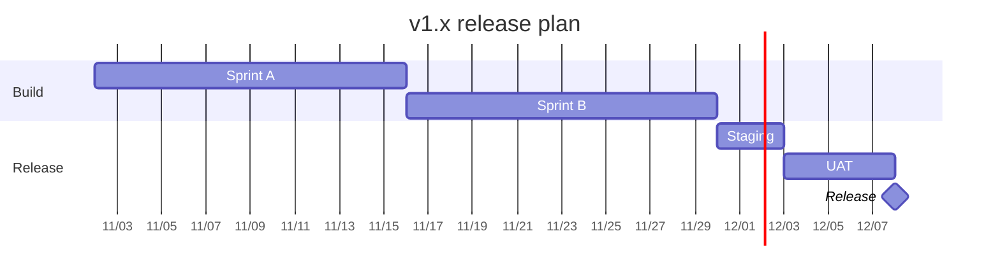

# Lên sprint theo Epic + User Story

Đúc kết từ Sprint 3 của PWPF (168, 11–13/10/2026): 7 Epic, 24 US, 21 issue cũ treo dưới US, 1 issue
cam kết, 2 issue hỏi khách. Skill này là **quy trình**; quyết định riêng từng dự án (ai là PM, mốc
thật, cấp độ từng dev) nằm ở memory của dự án — đọc nó trước.

**Luật chung** của bộ `delivery-*` (đọc hết thread, fetch nhánh chung, cổng nháp → duyệt → kiểm live, thang quyết định, hỏi khách): `../delivery-start/references/luat-chung.md`. Giọng văn và xưng hô trong team: `../sora-profile/references/van-phong.md`.

Phân công với skill khác:
- Gắn field board, chuyển trạng thái, lệnh `board.sh` → `delivery-board`.
- Một issue lẻ (bug, task nhỏ, câu hỏi đơn) → `delivery-write-issue`.
- Đặc tả mới chạm backlog thế nào → `delivery-spec-sync` chạy trước, skill này dựng backlog sau.

---

## 0. Tám luật gốc

1. **PM chỉ viết Epic + US.** Dev nhận US đăng comment **Solution — bắt buộc**: thiết kế, dữ liệu,
   API, rủi ro, ước lượng, cuối cùng là **bảng phủ** (mỗi quy tắc và AC → task nào làm, test nào
   chứng minh). **Task con (sub-issue dưới US) thì không bắt buộc**: US nhỏ có thể làm thẳng bằng một
   PR ghi `Refs #<US>`, khi đó cột task của bảng phủ ghi chỗ làm trong PR. Không soạn sẵn task kỹ thuật
   cho dev. *(14/10/2026, PR #756 / US #713: "không nhất thiết phải tách sub task dưới US … nhưng vẫn
   nên có solution". Chấm DoD: ô Solution vẫn trượt khi issue chưa có comment Solution.)*
2. **PM chỉ review Solution phức tạp**: đụng hạ tầng, kiến trúc (module / pattern / ranh giới
   context mới), mô hình dữ liệu (bảng hoặc cột mới, migration), phân quyền. Còn lại dev tự chốt,
   làm theo kiến trúc có sẵn. Cách chấm một Solution: skill `delivery-solution-review`.
3. **PM không ghi ước lượng vào issue.** Không person-days hay khối lượng do PM đoán trong Epic, US,
   cam kết. Dev ước lượng trong Solution và điền `Estimation days`. Để chia việc, PM giữ riêng ở
   `_plan/` sức từng người, hệ số tốc độ và điểm độ lớn của US, rồi đo tải (§B6).
4. **US luôn là issue mới.** Issue cũ không bị biến thành US; nó treo dưới US theo §B4.
5. **Mỗi Epic một người đảm nhiệm chính**, ưu tiên giữ ai đang tập trung việc gì. Trong tiếng Việt
   viết "do X sẽ đảm nhiệm chính", **không** viết "X làm chủ" (user chê nghe không hay). Tiếng Anh
   trong thân issue dùng "lead" / "owner".
6. **Ngôn ngữ:** thân Epic / US / task tiếng Anh 100% (thuật ngữ nghiệp vụ Nhật giữ nguyên trong
   câu); comment gửi team tiếng Việt theo `../sora-profile/references/van-phong.md`; câu hỏi khách JA + EN.
7. **Nháp trước, duyệt rồi mới đăng, đăng theo đợt.** Mỗi đợt có trang duyệt; chỉ đăng khi user nói
   rõ "đăng". Đăng xong tải về so với file.
8. **Gắn người nhận trước khi comment.** Comment báo thay đổi phải đến đúng người đang giữ issue —
   gắn assignee (người đảm nhiệm chính Epic) xong rồi mới đăng đợt comment.

---

## 1. Quy trình

### B1. Gom đầu vào (chỉ đọc)

- **Bản ghim đặc tả** trên nhánh chung: fetch rồi đọc `docs/requirements/source/` ở `origin/develop`,
  ghi sha. Mọi trích dẫn dạng `path@<sha> (version) §x.y`.
- **Thông báo thay đổi** của đợt này (số §, ngày gửi), câu trả lời của khách trên GitHub.
- **Năng lực đội**: ai toàn thời gian, ai hỗ trợ bao nhiêu %, ai bận tuần nào, **cấp độ từng người**
  (junior / middle / senior); **ai đang tập trung việc gì thì giữ** (ví dụ người đang làm Dropbox
  nhận Epic Dropbox).
- **Mốc thật** (staging, UAT, dev xong, phát hành) từ memory dự án — due date milestone trên GitHub
  có thể lệch; nhắc user sửa nếu lệch.
- **Issue đang mở** của sprint cũ và backlog: đọc hết thread comment từng issue trước khi xếp loại.

### B2. Dựng thư mục nháp

`SoraVaults/<dự án>/sprint <N>/` trong vault (luật chung §6:
`D=$(bash ~/.config/herdr-app/skills/delivery-start/scripts/vault-path.sh "sprint <N>")`), **mỗi issue đúng
một file**, chia thư mục theo Epic (`epic-<k>-<slug>/`), cộng `other/`, `_plan/`, `templates/`,
`_archive/`. `README.md` theo `assets/drafts-readme.md`: quy ước dòng STATE, chỉ mục, việc treo,
**sổ đã đăng**. Sửa nháp thì sửa đúng file đó — không tạo bản v2 / edit / revise bên cạnh.

### B3. Soạn Epic và US

Mẫu: `assets/epic.md`, `assets/user_story.md` (cũng là mẫu GitHub issue nên commit vào
`.github/ISSUE_TEMPLATE/`). Quy tắc nội dung:

- **Ít US, mỗi US trọn một kết quả người dùng thấy được**; gom việc nhỏ cùng màn / cùng quy tắc.
- **Today rà theo code** trên nhánh chung mới nhất (ghi commit), tìm theo tên tính năng chứ không chỉ
  theo mã lỗi. Lý do: từng đăng một US cho tính năng đã giao, và ghi sai người đóng yêu cầu.
- Quy tắc nghiệp vụ đánh số, mỗi quy tắc tự đứng được và có nguồn. Đặc tả im lặng / mâu thuẫn →
  giữ như demo / code / PR đang làm, ghi rõ trong quy tắc; nghiệp vụ chặt mà tài liệu không ghi →
  đưa vào câu hỏi khách (§B11), quy tắc ghi phương án mặc định.
- **Vẽ thay tả** theo `../delivery-start/references/so-do.md`: Epic có sơ đồ use case (mỗi use case một US, ghi số US), US có mục Flow (luồng theo làn vai trò, vòng đời trạng thái, chuyển màn, hoặc sequence mức nghiệp vụ). Mỗi bước trong luồng ứng với một quy tắc hoặc AC; bước không có AC là chỗ hổng.
- AC đánh số `- **AC-n**`, mỗi AC một kiểm tra quan sát được, chỉ tiếng Anh (script đo tải đếm
  đúng dạng dòng này).
- Bảng **Existing issues** (task / phần đã giao), bảng **Reference material** (mỗi dòng phục vụ AC
  nào), **DoD**, mục **How dev takes this** (câu duyệt Solution theo luật 2).
- Phát hiện kỹ thuật lúc rà để trong `<details>` "Notes for the developer (non-binding)".
- Không có mục Size / ước lượng.
- **Task đứng riêng** (không có Epic / US cha) vẫn viết thân theo form US: Story · Today · Flow (khi có luồng) · Business
  rules có nguồn · AC · Out of scope · Reference material · DoD · How dev takes this · `<details>` ghi
  chú non-binding · Sources. Khác US: tiêu đề `[Task]`, không nhãn `epic:*`, không mục Existing issues,
  DoD ghi `Refs #<this task>`, bảng phủ trỏ tới chỗ làm trong PR. Không dùng khuôn kỹ thuật cũ của
  `delivery-write-issue` (Parent requirement / Technical scope). *(15/10/2026: "task riêng thì cũng
  phải viết form giống US đi".)*
- **Gắn một issue vào Epic chỉ khi nó khớp mục tiêu của Epic**, không chỉ vì cùng nhãn hay cùng
  module (15/10/2026: từng đề xuất gắn #714 vào Epic chỉ vì cùng nhãn E03).

### B4. Xếp loại issue cũ

| Issue cũ | Làm gì | Mẫu |
|---|---|---|
| Đang mở, **chưa có PR thật** | **Task** của US: comment tiếng Việt ghi thay đổi, rồi thay tiêu đề + thân (đầu thân dẫn link comment), mốc + nhãn epic theo US, chuyển cha sang US | `assets/old-issue-task.md` |
| Đang mở, **đã có PR** (merge hoặc đang mở) | **Phần đã giao**: chỉ comment, giữ phạm vi, QA theo phạm vi cũ; yêu cầu mới nằm ở US | `assets/old-issue-delivered.md` |
| Đã đóng, hoặc board ghi Done (đóng trước khi đăng) | Không comment, **không gắn làm sub-issue** — thanh tiến độ US sẽ tính nhầm việc cũ là việc mới | — |
| Chỉ còn là câu hỏi / thông báo | Comment riêng hoặc đóng, ở `other/` | — |

"Có PR" = PR **thực sự làm** issue đó (`Refs #N`, mô tả đúng việc), kiểm qua timeline cross-reference
rồi đọc thân PR; PR chỉ nhắc tên (PR ghim đặc tả, PR nền) không tính.

Comment cho từng người: xưng hô theo `../sora-profile/references/van-phong.md` §2; nếu đổi người nhận thì nói rõ "chuyển
người nhận từ @A sang …, vì Epic … do … sẽ đảm nhiệm chính". Câu cuối đoạn mở: "ngay sau comment này
em/anh thay tiêu đề và thân issue" (comment không chứa bản thân mới, đừng viết "theo bản bên dưới").

### B5. Kế hoạch sprint và issue cam kết

- Chia Epic cho người đảm nhiệm chính (luật 5). Ai đóng xong Epic của mình thì nhận Epic kế tiếp.
- US chia hai rổ: **finished** (xong trong sprint, demo từng AC) và **started** (đã đăng Solution,
  đang làm, xong sprint sau). Cam kết phải nói rõ **US nào demo được**. Khi đội có thêm nguồn lực
  (tài khoản bên ngoài đã có, dev dùng AI) thì đẩy thêm US sang rổ finished — nhưng chỉ khi bảng
  tải §B6 còn chỗ.
- Issue cam kết là **issue thật** (`Kind = Commitment`), theo `assets/commitment.md`:
  - dòng **Draft** ở đầu: chốt sau khi dev ước lượng, mọi thay đổi so với nháp ghi lại trên issue;
  - US đã có cha là Epic (sub-issue chỉ có một cha) → liên kết bằng **danh sách checkbox**, không
    gắn sub-issue;
  - có Sprint Goal, bảng Epic → người đảm nhiệm chính, demo plan, acceptance checklist, phụ thuộc
    khách, rủi ro; không có ước lượng của PM.
- Tạo cam kết **sau** khi Epic / US đã có số.

### B6. Chia tải — biết ai quá tải

PM muốn thấy mỗi người gánh bao nhiêu và có ai quá tải không, kể cả **trước khi dev ước lượng**.
Hai file trong `_plan/` (mẫu ở `assets/`), một script `scripts/load.py` với ba chế độ.

**1. Sức từng người — `capacity.json`.** Số ngày làm việc của sprint, tỉ lệ thời gian cho dự án
(`allocation`), ngày nghỉ / bận dự án khác (`off_days` + `note`), cấp độ (`level`), **hệ số tốc độ**
(`speed`). Sức = (ngày làm việc − ngày nghỉ) × tỉ lệ; sức hiệu dụng = sức × hệ số tốc độ.
- Hệ số tốc độ = một ngày của người đó làm được bao nhiêu việc so với mặt bằng đội.
- **Sprint đầu dùng giả định theo cấp** (junior 0.7 · middle 1.0 · senior 1.2 — PWPF chốt giữ hệ số
  13/10/2026; đội dùng Claude 100% nên khoảng cách hẹp hơn mức thường gặp). Ghi rõ trong
  `speed_source` đây là giả định — không trình bày nó như số đo.
- **Từ sprint sau dùng số đo** (chế độ `calibrate`): hệ số đo của từng người thay hệ số theo cấp.

**2. Độ lớn việc — `sizing.json`** (chỉ PM xem, không ghi vào issue).
- Điểm theo số AC của US (script đếm dòng `- **AC-n**` trên GitHub): ≤ 8 AC = 1 · 9–12 = 2 · ≥ 13 = 3.
- Cộng rủi ro: cao +2 (hệ thống ngoài, logic lõi nhiều màn dùng, gộp / sửa dữ liệu hàng loạt),
  vừa +1 (bảng hoặc cột mới, dữ liệu cũ, phụ thuộc US khác chưa xong), thấp +0. Rủi ro do PM chấm
  khi đọc US — ghi lý do ngắn trong `note`.
- US chỉ "bắt đầu" trong sprint tính 50%; người được ghi `reviewer` gánh 20% điểm của US đó.
- Issue không có danh sách AC (issue cũ, việc v1.2) ghi thẳng `points`.
- Thử phương án khác: sửa `assignee` / `started` / `reviewer` trong một bản sao rồi chạy lại.

**3. Chạy và đọc**

| Lúc | Lệnh | Đo gì |
|---|---|---|
| Lên kế hoạch, **dev chưa ước lượng** | `load.py plan --capacity … --sizing … --details` | Điểm từng người ÷ phần công bằng (tổng điểm chia theo tỉ lệ sức hiệu dụng) |
| **Dev đã ước lượng** (Estimation days trên task) | `load.py estimates --capacity …` | Ngày việc còn lại ÷ sức còn lại — không nhân hệ số, vì ước lượng của dev đã chứa tốc độ của họ |
| **Cuối sprint** | `load.py calibrate --capacity … --sizing …` | Điểm việc xong ÷ Actual days, so với trung vị đội, trộn với hệ số cũ (hệ số cũ nặng bằng 5 việc; càng nhiều việc xong, số đo càng nặng) |

- Tải tương đối > 1.2 hoặc > 100% sức còn lại: **quá tải** → chuyển US từ "xong" sang "bắt đầu",
  chuyển cho người khác trong Epic, thêm senior review, hoặc tách US. Quyết trước khi chốt cam kết.
- > 1.0 hoặc > 80%: hơi nặng, không nhận thêm. < 0.8: còn dư, có thể nhận thêm hoặc kèm review.
- **Luật rủi ro theo cấp độ** (script tự báo): junior không giữ US rủi ro cao ở rổ "xong" nếu không
  có senior `reviewer`. Dữ liệu PR Sprint 1–2 của PWPF ủng hộ luật này: junior có tỉ lệ bị yêu cầu
  sửa cao nhất (0.47 lần / PR, senior 0.18).
- **Xét từng người, không chỉ cả đội** (Sprint 3: cả đội 68% nhưng một người 200%).
- Chạy lại khi chốt cam kết, thứ Sáu tuần 1, và khi có việc gấp chen vào (`Lane = Ad-hoc`).
- Giữa sprint, "sức còn lại" tính theo tỉ lệ số ngày còn lại — người có ngày nghỉ dồn vào một tuần
  thì đọc dòng đó bằng tay.

**4. Thu số liệu để hệ số thành số đo** — nhắc đội ngay đầu sprint, không có thì `calibrate` không
chạy được:
- Mỗi task có `Estimation days` trước khi bắt đầu, **`Actual days` khi chuyển sang Ready for QA**.
- PR ghi `Refs #<task>` để việc xong nối được về task.
- 13/10/2026 kiểm board PWPF: chỉ 10 item có Actual days (8 của một người); 96 PR merge từ 14/09
  nhưng phần lớn nối tới issue không có ước lượng → chưa tính được hệ số từ lịch sử.

### B7. Trang duyệt cho từng đợt

Dựng một trang (artifact, tiếng Việt dẫn) liệt kê mỗi issue: thay đổi sẽ làm (cha cũ → US, người
nhận, mốc, nhãn) rồi văn bản sẽ đăng (render markdown). Ghi rõ issue nào bị loại khỏi đợt và vì sao.
Chờ chữ "đăng". Mỗi lần nháp đổi thì dựng lại trang.

### B8. Đăng — thứ tự đã chạy được

1. **Đợt 1 — issue mới:** tạo Epic → US (điền `#<Epic n>`, `#<US x.y>` bằng số thật) → gắn US làm
   sub-issue của Epic → câu hỏi khách. Tải từng thân về so với file.
2. **Board issue mới** (theo `delivery-board`): `Kind = Epic / Story / Clarification`,
   `Project`, `Source`, `Priority`; US trong cam kết: `Sprint`, `Lane = Sprint`, `Todo`, ngày bắt
   đầu / hạn (finished = cuối sprint, started = hạn dev xong); còn lại `Backlog`. `Estimation days`
   để dev điền.
3. **Milestone:** Epic và US → milestone phát hành chứa chúng (ví dụ v1.3). Issue `Clarification`
   và `Commitment` **không** gắn milestone (lệ cũ của repo).
4. **Issue cam kết** (B5) + field board giống cam kết sprint trước.
5. **Board issue cũ:** gắn Sprint cho việc làm tiếp, gỡ `Blocked` / `Waiting on` khi hết chặn, gỡ
   Sprint khỏi task của US sprint sau. Issue board ghi Done mà còn mở → đóng completed trước đợt 2.
6. **Gắn người nhận** theo người đảm nhiệm chính Epic (luật 8), gỡ người cũ; kiểm lại bằng GraphQL.
7. **Đợt 2 — issue cũ:** `scripts/post_old_issues.py` — `plan` (đưa user xem) → `run` → `verify`
   → `mark`. Script comment trước, rồi thay tiêu đề / thân / nhãn / mốc (task), rồi chuyển cha bằng
   `replace_parent: true`; tiến độ lưu vào file state nên chạy lại an toàn.
8. **Sổ:** đổi dòng STATE, đổi tên file theo số, thêm một dòng vào "Sổ đã đăng" của README.

### B9. Kiểm trước khi đăng (mỗi đợt)

- Tải lại trạng thái từng issue: còn mở không, có comment mới sau lúc soạn không (đọc nó), cha hiện
  tại, nhãn, mốc, người nhận.
- **PR có thể đã merge giữa lúc soạn và lúc đăng** — câu "đang làm / chưa merge / đang review" trong
  nháp phải sửa (Sprint 3: PR #699 merge cùng ngày đăng).
- Không còn placeholder: `#<…>`, `<COMMENT_PERMALINK>`, `#<this task>`.
- Ngày "Rewritten YYYY-MM-DD" là ngày đăng.
- Sơ đồ đủ theo `../delivery-start/references/so-do.md`: Epic có mục Use cases ghi số US thật (không còn `US 000`); US có mục Flow khi luồng từ 3 bước, có rẽ nhánh, có trạng thái hoặc đi qua từ 2 màn hình, không thì ghi "No flow: …". Khối mermaid render được (xem trước trên GitHub).
- Sửa kiểu này là sửa sự thật, không đổi ý: làm luôn, rồi báo user đã sửa gì. Riêng thiếu sơ đồ là thiếu nội dung: vẽ bổ sung, đưa user duyệt rồi mới đăng.

### B10. Dọn issue module của sprint cũ

| Tình trạng sub-issue | Làm gì |
|---|---|
| Tất cả đã đóng completed | Board → Done, đóng **completed** |
| Không còn sub-issue (đã chuyển hết sang US) | Board → Done, đóng **not planned** kèm comment chỉ chỗ từng issue con đã chuyển |
| Còn một sub-issue đang làm / chờ QA | **Giữ mở** tới khi QA xác nhận nó, rồi đóng completed (user chọn ở #634) |

### B11. Gom câu hỏi khách thành một Clarification

- **Một issue** gom mọi điểm, theo `assets/clarification-batch.md` (tiền lệ: #586, #737, #740 của
  PWPF). Không rải comment lên issue đã đóng / PR đã merge; Slack chỉ cho câu hỏi nhanh một lần.
- Tách hai phần: **Questions** (khách phải chọn: phương án Sora đề xuất + ví dụ + căn cứ + việc làm
  khi quá hạn) và **Document fixes** (tài liệu tự mâu thuẫn nhưng nguồn mới nhất đã rõ: Sora làm
  theo nguồn đó, nhờ sửa, chỉ cần báo nếu không đồng ý).
- Kiểm từng điểm trước khi hỏi: điểm nào tài liệu mới nhất đã chốt thì **không hỏi**, chuyển sang
  Document fixes (Sprint 3: khổ in A4/A3 hoá ra v2.59 đã chốt A3).
- **Hạn trả lời** có thứ + ngày + lý do gắn mốc thật, câu mời báo sớm, phương án quá hạn cho từng câu.
- Board giống Clarification trước đó: `Blocked`, `Kind = Clarification`, `Waiting on = <khách>`,
  `Deadline`; không Sprint, không milestone, không người nhận.
- **Câu hỏi phát sinh giữa sprint**, khác chủ đề hoặc khác hạn với Clarification đã đăng → **mở
  Clarification riêng**, không nhét thêm vào issue đã đăng cho khỏi trôi (15/10/2026, tiền lệ #754:
  tag người chốt phía khách đầu thân, Related / Answer by / Question song ngữ).

### B12. Sau planning

- Chốt cam kết khi dev đã đăng Solution + ước lượng **và bảng tải `estimates` (§B6) không còn ai
  quá tải**: sửa thân, ghi thay đổi so với nháp, gỡ dòng Draft.
- Theo dõi hạn trả lời của khách; quá hạn thì ghi một dòng chốt theo phương án mặc định.
- Cuối sprint: `load.py calibrate` → ghi hệ số mới vào `capacity.json` của sprint sau.

### B13. Kế hoạch phát hành — một bản cho mỗi milestone

Sprint là nhịp làm; milestone (v1.3…) là mốc giao cho khách và trải nhiều sprint. Kế hoạch phát hành trả lời: giao gì, ngày nào, thế nào là đủ để phát hành. Không có kho riêng — theo mô hình lưu trữ (`../sora-profile/references/quy-trinh.md` §11):

| Phần | Nằm ở | Vì sao |
|---|---|---|
| Phạm vi (Epic / US), các mốc ngày, điều kiện đủ để phát hành | **mô tả milestone** trên repo issue (tiếng Anh) + `due date` = ngày phát hành | là cam kết với khách, khách đọc được trên GitHub |
| Danh sách việc ngày phát hành (thứ tự deploy, migration, kiểm sau deploy, rollback) | runbook trong repo dev (`docs/…`) hoặc trang wiki PMS nội bộ | tài liệu vận hành nội bộ |
| Bản nháp | `_plan/release-<milestone>.md` trong thư mục nháp sprint | duyệt trước khi ghi |

Nội dung mô tả milestone:

- **Scope:** danh sách Epic và US (link), mỗi US một dòng; US hoãn sang milestone sau ghi rõ.
- **Dates:** dev xong · lên staging · khách nghiệm thu (UAT) bắt đầu / kết thúc · phát hành. Lấy từ mốc thật trong memory dự án (lịch / WBS), không lấy từ due date cũ.
- **Exit criteria:** mọi US trong milestone ở `Ready for Release`; checklist nghiệm thu của khách đã tick; migration đã chạy thử trên staging; có kế hoạch rollback (`delivery-dev-operate`); Clarification liên quan đã trả lời, hoặc ghi rõ hoãn.

Bản nháp `_plan/release-<milestone>.md` vẽ các mốc ở **Dates** thành `gantt`: nhìn một lần thấy sprint nào xong khi nào, UAT dài bao lâu, ngày phát hành cách bao xa. Mô tả milestone giữ danh sách ngày dạng chữ: chưa kiểm được trang milestone của GitHub có render Mermaid không (GitHub công bố render ở issue, discussion và file markdown). Khách cần thấy sơ đồ thì dán vào báo cáo tuần (`../delivery-board/references/playbooks.md` P6) ở tuần lập hoặc đổi kế hoạch. Dự phóng lệch thì sửa sơ đồ cùng lúc với danh sách ngày.



Nhịp:

- **Lập** khi milestone được chốt với khách; **soát lại ở mỗi Planning** (B5): US nào của milestone chưa nằm trong sprint nào; dự phóng ngày xong bằng `report.sh milestone` (`delivery-report` §6).
- **Lệch** (dự phóng vượt `due date`): nêu đúng hai lựa chọn — bỏ / hoãn phạm vi nào, hoặc lùi mốc bao nhiêu ngày — rồi người dùng chọn và báo khách qua issue. Không lặng lẽ dời `due date`.
- Ghi mô tả milestone: `gh api -X PATCH repos/<owner>/<repo>/milestones/<n> -F description=@<file>` (sau khi duyệt), tải lại và so khớp với nháp.

---

## 2. Công cụ và bẫy đã gặp

- **Ghi lên GitHub trong Claude Code:** `gh issue create / edit / close` chạy thẳng hay bị bộ phân
  loại auto-mode chặn. Khi user đã cho phép rõ, gọi REST qua `gh api` trong script Python
  (`POST /issues`, `PATCH /issues/N`, `POST /issues/N/comments`, `POST /issues/<US>/sub_issues`) —
  đã chạy được. **Đóng issue:** đưa user một lệnh để tự chạy, kèm comment nếu cần:
  `gh issue close N --repo OWNER/REPO --reason completed` hoặc
  `--reason "not planned" --comment "…"`. Không tìm cách lách khi bị chặn.
- **Sub-issue chỉ có một cha.** Chuyển cha: `POST repos/O/R/issues/<US>/sub_issues` với
  `{"sub_issue_id": <databaseId>, "replace_parent": true}` (databaseId, không phải số issue).
- **`Refs #N` không tạo link ở mục Development**; `Fixes / Closes / Resolves` bị cấm vì issue tự
  đóng khi merge vào nhánh mặc định. Muốn link Development thì làm tay sau khi PR merge.
- **`board.sh`**: gọi `bash …/board.sh` (file không có quyền thực thi); `item` / `set` cần dạng
  `owner/repo#N`, số trần báo lỗi. Lựa chọn `Kind` Epic / Story phải được user thêm trong GitHub UI
  trước (Sprint 3: lần đầu user tạo nhầm hai trường chữ).
- **Đọc nhiều issue một lần:** một truy vấn GraphQL với alias `i<N>: issue(number:N){…}`; gặp 504
  thì chia nhỏ hoặc dùng REST. `gh pr list --json reviews,body` cho nhiều PR dễ trả JSON cụt — lấy
  reviews riêng bằng GraphQL theo nhóm 25 PR.
- **zsh:** `echo ====` lỗi (dấu `=` đầu từ), URL có `?` phải để trong nháy đơn.
- **Sửa file bằng script Python:** dựng xong nội dung rồi mới `open(p, 'w')` — mở trước rồi lỗi
  giữa chừng là file bị xoá trắng (đã xảy ra với chính file này).
- **Scratchpad bị xoá khi phiên khởi động lại** — script dùng lâu dài để trong skill này, không để
  trong scratchpad.
- **Kiểm sau khi đăng** luôn bằng cách tải lại (tiêu đề, thân, comment, cha, mốc) và so chuỗi với
  file — báo con số "khớp n/n", không báo "đã đăng" suông.

---

## 3. Tài nguyên

| File | Dùng khi |
|---|---|
| `assets/epic.md`, `assets/user_story.md` | Soạn Epic / US (cũng là mẫu `.github/ISSUE_TEMPLATE/`) |
| `assets/old-issue-task.md` | Nháp issue cũ chưa có PR → task |
| `assets/old-issue-delivered.md` | Nháp issue cũ đã có PR → phần đã giao |
| `assets/commitment.md` | Issue cam kết sprint |
| `assets/clarification-batch.md` | Issue gom câu hỏi khách + nhờ sửa tài liệu |
| `assets/drafts-readme.md` | README của thư mục nháp |
| `../sora-profile/assets/capacity.json` (mẫu sức team), `assets/sizing.json` | Sức + hệ số tốc độ từng người; điểm độ lớn từng việc (§B6) |
| `scripts/load.py` | Bảng tải: `plan` (chưa có ước lượng) · `estimates` (đã có) · `calibrate` (cuối sprint) |
| `scripts/post_old_issues.py` | Đăng đợt issue cũ: `plan` / `run` / `verify` / `mark` |

```bash
D=$(bash ~/.config/herdr-app/skills/delivery-start/scripts/vault-path.sh "sprint 4")
python3 ~/.config/herdr-app/skills/delivery-backlog/scripts/load.py plan \
  --capacity "$D/_plan/capacity.json" \
  --sizing "$D/_plan/sizing.json" --details
python3 ~/.config/herdr-app/skills/delivery-backlog/scripts/post_old_issues.py \
  --repo structuralengine/168-yahagi-panwall --drafts "$D" plan
```
