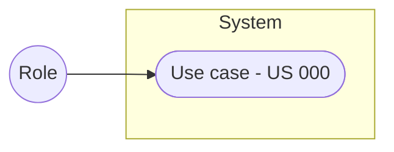

<!--
Who writes this: the PO. An Epic says WHY and WHAT, never HOW.
Add one area label too (epic:E01-物件コア … epic:E12-AWS基盤) and set the milestone.
Keep files out of an Epic: attach screenshots and input files to the user story that needs them.
-->

## Goal

<!-- One paragraph, in the user's words: what will people be able to do or see when this epic is done? -->

## Why now

<!--
The change that triggered it, with the numbers that survive a re-pin:
change notice §NNN (and its send date), requirement IDs (FR-/BR-/NFR-), spec section headings (§x.y).
Never cite an item number inside a section (§x.y(n)) — it gets renumbered silently.
Say which release keeps the old behaviour, if any (e.g. "v1.2 and UAT round 1 keep today's screen").
-->

## Use cases

<!--
Who uses the system for what in this epic. Each actor is a role; each use case becomes one user story,
labelled with its number (write `US 712`, not `#712`: `#` breaks Mermaid).
Roles: round nodes (("...")). Use cases: rounded nodes (["..."]) inside the System box.
-->

## User stories

<!-- One line per story; they become sub-issues of this epic. An existing issue that takes the new requirement is listed with its own number. -->

- [ ] #<US>
- [ ] #<US>

## Out of scope

<!-- What a reader might expect here but belongs to another epic or a later phase. Name where it lives. -->

-

## Epic done when

- Every user story above is closed by QA on staging.
- `docs/features/` describes the rules this epic adds, in one place each.
-

## Sources

<!--
Pinned spec: `docs/requirements/source/<file>.md@<sha>` (version) §x.y — always with the sha, so a file rename cannot break the link.
Change notices: 変更通知 vNN §NNN (sent YYYY-MM-DD).
PMS wiki: link the SRS / design pages directly.
-->

-
