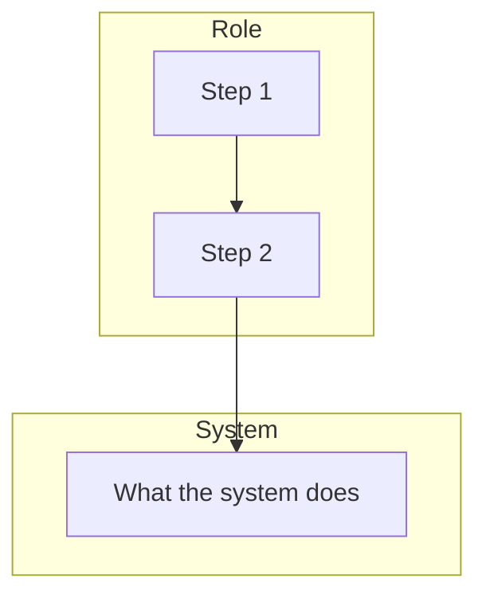

<!--
Who writes what:
- PO: everything down to "How dev takes this".
- Developer who takes the story: follows "How dev takes this".
- QA: tests every AC on staging and closes the story.
Set the parent epic (sub-issue), one area label (epic:E0x-…) and the milestone.
Write the body in English. Keep Japanese business terms verbatim (工事番号, 承認, 設計依頼 …).
-->

## Story

As a <role>, I want <what>, so that <why>.

## Today

<!-- What the user sees and does now, in business terms. No code. If an earlier version already shipped, say what stays. -->

## Flow

<!--
Draw the business flow instead of describing it (Mermaid renders on GitHub). Roles and business objects only, never modules or tables: the Solution draws those.
- Three or more steps, or a branch: a flowchart with one subgraph per role (swimlane).
- Rules about a status: a state diagram.
- A handoff between three or more parties (roles and the System): a sequence diagram.
- Two or more screens: a flowchart from screen to screen, screen codes and names as in the project's screen map, the button or action on each arrow.
Every step maps to a business rule or an AC below; a step with no AC is a gap.
If there is no flow, write: "No flow: one screen, one action."
-->

## Business rules

<!--
Numbered. Each rule is self-contained and cites its source (requirement ID or spec section heading).
A screen rule may say "the Malme demo is authoritative" only if a change notice says so — name the build date.
-->

1.
2.

## Acceptance criteria

<!--
AC-1, AC-2 … — English only, one observable check each, so QA can test it without reading anything else.
AC-n here is not citable in code: once the spec is promoted, cite `docs/features/<feature>.md AC-###`.
Never write "as in the attachment": a reference file is evidence for an AC, it never replaces one.
-->

- **AC-1**
- **AC-2**

## Out of scope

<!-- Name the issue or epic that owns each excluded item. -->

-

## Existing issues

<!--
Existing issues that belong to this story become its sub-issues:
- no PR yet: a **task** of this story. It may take the new requirement — comment the change on it, then rewrite its body as a task that points here.
- already has a PR (merged or open): a **delivered part**. It keeps its scope and is QA'd on it; anything new it would need goes in this story, never into it.
If there is none, write: "None yet. The developer may split the work into tasks."
-->

| Kind | Issue | Covers |
|---|---|---|
| Task | #<issue> | Rules … and the ACs that test them |
| Delivered part | #<issue> | What its PR delivered; unchanged |

## Reference material

<!--
Screen mock, demo build, input file, received customer file — anything QA or the developer must open to check an AC.
Every row says which AC it serves; a file that serves no AC does not belong here.
- Screenshots: drag them into this issue below the table.
- Input files the code reads (e.g. a customer CSV to import): commit them under docs/data/ and give the path, only if the file holds no personal data (names, contact details). Git history cannot forget a file, so a file with personal data stays off git: say where it is kept.
- Credentials, tokens, API keys, personal addresses: NEVER here. Say "handed over on Slack" instead.
If there is nothing, replace the table with: "None. The business rules above and the sources below are all this story needs."
-->

| What | Where | Needed for |
|---|---|---|
|  |  | AC- |

## Definition of Done

- [ ] Solution posted on this issue, ending with its coverage table, and reviewed by the PO before coding when "How dev takes this" asks for it
- [ ] Each PR says `Refs #<this US>`, plus `Refs #<task>` for each task it builds
- [ ] Every AC passes on staging, checked by QA against this issue
- [ ] `docs/features/<feature>.md` updated (rules + AC IDs)
- [ ] JA / EN strings complete (`npm run check:i18n`); English labels fit the screen
- [ ] Lint, type check and tests green (frontend + backend verification loop)

## How dev takes this

- **Solution, always.** Read the rules and AC, then post a Solution comment here: design, data changes, API, risks, how each AC will be tested, your estimate.
- **Coverage table.** The Solution ends with one row per business rule and per AC: the task that builds it (or the part of the PR, with no tasks) and the test that proves it. A rule or AC with no row is a gap.
- **Diagrams, not prose** (Mermaid renders on GitHub):
  - sequence: every new or changed call path through three or more parts (screen → API → service → database, another module or an outside system), or a write that touches several tables in one transaction;
  - ER: every new or changed table or column, marked `NEW`;
  - state: a status or its transitions change.
  Keep prose for what a diagram cannot say: why this design, the trade-offs, the risks.
- **Tasks are optional.** Split the work into tasks (sub-issues of this US) only when it helps; a small story can go in one PR that says `Refs #<this US>`. A task that changes behaviour no rule asks for is out of scope: raise it instead.
- **PO review only when the solution touches** infrastructure, the architecture (a new module, pattern or cross-context boundary), the data model (a new table or column, a migration) or permissions. Otherwise decide yourself: follow `.claude/rules/architecture.md` and `.claude/rules/design-patterns.md`, and start coding.

<!--
Coverage table the Solution must end with — one row per rule and per AC, nothing left blank:

| Rule / AC | Task (or PR part) | Test |
|---|---|---|
| Rule 1 | #<task> | test_<name> |
| Rule 2 | #<task> | test_<name> |
| AC-1   | #<task> | test_<name> (or: manual check on staging, steps listed) |
| AC-2   | #<task> | test_<name> |
-->

<!-- Add here anything the solution MUST settle (an open decision, a dependency on another story, a release constraint). -->

Notes for the developer (non-binding)

<!-- Code pointers found while writing the story: file paths with line numbers and the commit they were read at. The developer re-checks them; they are not a design. -->

## Sources

<!--
Pinned spec: `docs/requirements/source/<file>.md@<sha>` (version) §x.y.
Change notices: 変更通知 vNN §NNN (sent YYYY-MM-DD).
Decisions on GitHub: link the comment, not the issue.
PMS wiki: link the page.
-->

-
