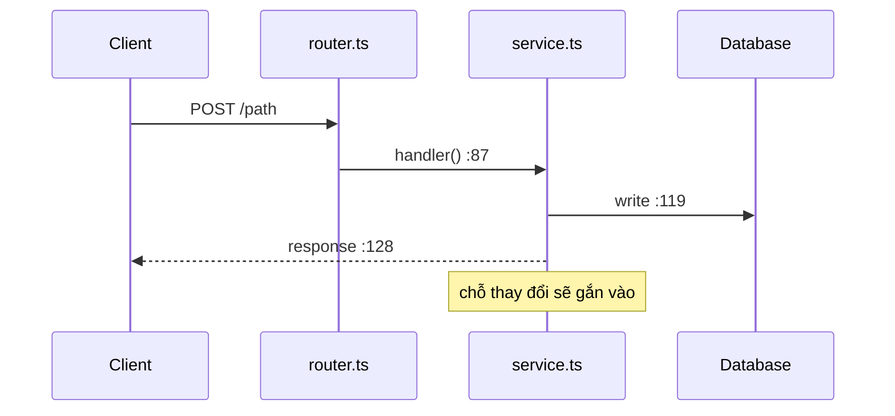
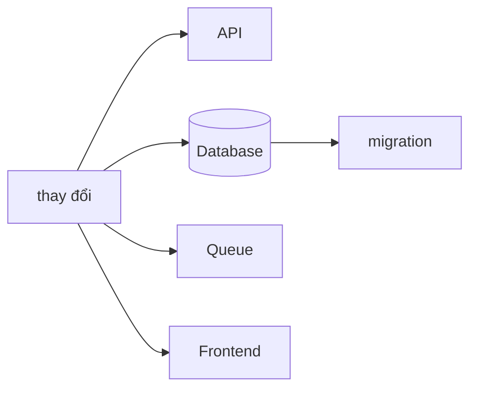

# Devflow · Phase 5 — Investigation

Read `../delivery-dev/references/conventions.md`, `../delivery-dev/references/writing-policy.md` and `../delivery-dev/references/supporting-artifacts.md` first.

**In:** `context.md` + `understanding.md` (`READY`) · **Out:** `05-investigation.md` (+ `04-baseline.md`, `06-impact.md` when routed) · **State:** `REPRODUCING → INVESTIGATING → ROOT_CAUSE_ANALYSIS → IMPACT_ANALYSIS`

**Gate-in (bắt buộc, trước mọi việc khác):** `~/.config/herdr-app/skills/delivery-dev/scripts/delivery-dev-gate.sh <issue> investigate` — paste nguyên output vào mục `## Gate-in` đầu artifact. `GATE: FAIL` ⇒ **không chạy phase này**: xử lý dòng FAIL hoặc dừng và báo (conventions §3b). Không có khối Gate-in trong artifact = phase chưa chạy hợp lệ.

## Job

Answer **how it behaves today, why, and where the change belongs** — from the repository, not from assumption.

Gate in: `understanding.md` must say `UNDERSTANDING_STATUS: READY`. `NEED_CLARIFICATION` ⇒ stop, the question comes first.

Three steps, the outer two conditional (`status.md` decides):

```text
[A] Baseline / reproduce  → baseline.md    BUG · PERFORMANCE · regression · incident
[B] Investigate + root cause → investigation.md   always
[C] Impact analysis       → impact.md      Complexity ≥ MEDIUM · Risk ≥ MEDIUM · prod impact · cross-module
```

---

## A. Baseline / Reproduce (conditional)

Establish what the system does **today**, with evidence, before anyone changes it. Without a baseline there is nothing to prove the fix against.

1. Reproduce from the issue's steps. Cannot reproduce ⇒ say so and list what you tried and what differed (env, data, version, config).
2. Record the observed behavior — error text, status code, log line, screenshot reference.
3. **Task UI "khớp demo/mockup"** ⇒ baseline là số đo, không phải nhận xét: chạy `delivery-ui-measure` (capture demo + app, diff) trên các viewport và state của AC, lưu `report.md` + ảnh vào `evidence/ui-today/`, đối chiếu với bảng "Today" của issue. Lệch ngoài bảng ⇒ báo thêm vào task trước khi code. Chưa có công cụ hoặc app chưa chạy được ⇒ ghi `NOT_RUN (lý do)`, không ước lượng số.
4. Performance issue ⇒ measure before touching code: p50 · p95 · p99 · RPS · CPU · memory · DB CPU · query count. Only the metrics the issue is about.
5. Note the environment: branch/commit, env, dataset, how load was generated.

**Never invent baseline data.** No made-up latency, no plausible-looking p95. Not measured ⇒ `NOT_MEASURED` plus the reason. A wrong baseline poisons every later claim of improvement.

```md
# Baseline

Env: <branch/commit, environment, dataset>

Expected: ...
Actual: ...

Reproduction:
1. ...

Evidence:
<log line, status code, command output>

## Metrics (performance issue only)

| Metric | Value | How measured |
|---|---|---|
| p95 | 7.2s | `hey -n 200 -c 10 …` trên staging |

---

BASELINE_STATUS: REPRODUCED | NOT_REPRODUCED | PARTIAL
```

`NOT_REPRODUCED` ⇒ do **not** start guessing a fix. Report what was tried, ask for the missing piece (env, data, steps, logs), and treat any later diagnosis as `HYPOTHESIS`.

`REPRODUCED` ⇒ the reproduction becomes the failing test in `delivery-dev-plan`'s test strategy.

---

## B. Investigate + Root Cause

1. Start from the architecture context in `context.md`, then search the repository for each requirement. Never guess the architecture.
2. Identify, as they apply: entry points · related modules · services · controllers/routes · models · repositories · database tables · external APIs · events · queues · workers · configuration · existing patterns · existing tests.
3. Trace the current flow end to end, and read the code — not just the file names.
3a. Issue đụng frontend (role FRONTEND / UX active) ⇒ dùng skill `find-mockup-repo` với mã dự án để xem mockup thật trong `~/Documents/SoraTech/mockup-ui/`, và ghi đường dẫn vào Evidence. Không có mockup ⇒ `UNKNOWN`.
4. Find the **existing pattern** for this kind of change (how the repo already solves a similar problem) and prefer it.
5. Bug / performance / security ⇒ root-cause analysis.
6. Write `05-investigation.md`; every technical conclusion carries a label and evidence.

**Phát hiện một migration / seed / schema-DDL / shared-state-machine mà route (`status.md`) không có ⇒ đây là misroute, không phải chi tiết nhỏ.** Quay lại `delivery-dev-classify` (fail-closed re-route: bật DBA + OPERATIONAL_CHECK, nâng Risk), cập nhật `status.md`, rồi mới tiếp — ghi vào `investigation.md`.

For a broad sweep across an unfamiliar codebase, an `Explore`-style read-only search agent is fine — the conclusions still land in `investigation.md` with concrete paths.

### Root cause

```text
Symptom → Evidence → Root Cause → Contributing Factors → Impact
```

**Symptom ≠ root cause.** "Payment API trả 504" is a symptom; "client timeout 5s trong khi p95 của external API ~7s" is a cause.

```text
Symptom: Payment API trả 504.
Evidence: baseline.md p95 = 7.2s; `PaymentClient(timeout=5)` (payment/client.py:22).
Root cause: client timeout ngắn hơn p95 của external API.
Contributing: không có xử lý riêng cho timeout, không retry.
Impact: ~3% request payment fail giờ cao điểm.
```

Cannot prove it ⇒ `ROOT_CAUSE_STATUS: HYPOTHESIS` plus what would confirm it. **Never present a hypothesis as the cause** — a fix built on the wrong cause passes review and fails in production.

### Template

```md
# Investigation

**TL;DR**
- <kết luận: thay đổi đặt ở đâu>
- <root cause, nếu có>
- <blocker / rủi ro lớn nhất>

## 1. Requirement Mapping

| AC | Requirement | Code Location | Current Behavior |
|---|---|---|---|
| AC-1 | ... | `path/to/file.py:120` | ... |

## 2. Related Files
- `path/to/file` — vì sao liên quan

## 3. Current Flow

**Bắt buộc vẽ bằng `sequenceDiagram`** (writing-policy §7b) — không tả bằng văn xuôi:



Chỉ giữ thêm 1–2 dòng chữ cho điều diagram không diễn đạt được (idempotency, transaction boundary, retry).

## 4. Current Behavior
## 5. Problem

## 6. Existing Pattern
<pattern repo đang dùng cho loại thay đổi này, kèm file ví dụ>

## 7. Root Cause  (bug / performance / security)
Symptom: ...
Evidence: ...
Root cause: ...
Contributing: ...

ROOT_CAUSE_STATUS: CONFIRMED | HYPOTHESIS

## 8. Risks
- ...

## 9. Technical Recommendation
<nơi đặt thay đổi + lý do, dựa trên evidence>

## 10. Evidence

FACT: `payment/service.py:64` — `PaymentService.create()` gọi `PaymentClient.request()`.
INFERENCE: Retry đặt ở `PaymentClient` để mọi caller dùng chung policy.
ASSUMPTION: Mọi caller muốn cùng retry policy. (Confirm: hỏi issue author.)
UNKNOWN: External API có idempotency key không. (Blocking cho thiết kế retry.)

---

INVESTIGATION_STATUS: READY | NEED_MORE_INVESTIGATION | NO_CHANGE
```

### Evidence rule

Every important conclusion is labeled `FACT` / `INFERENCE` / `ASSUMPTION` / `UNKNOWN` (conventions §4) and backed by a real location in this repository.

Not acceptable:

```text
I think this should probably be changed in X.
```

Acceptable:

```text
FACT: `PaymentService.create()` gọi `PaymentClient.request()` (payment/service.py:64).
INFERENCE: Mọi caller đều đi qua `PaymentClient`, nên retry đặt ở đó để dùng chung một policy.
```

---

## C. Impact Analysis (conditional)

Answer *what else does this touch* — before the solution is designed, so the design can account for it.

Walk the list, keep only what is really affected:

```text
API · Database · Cache · Queue · Worker · External API
Frontend · Mobile · Authentication · Authorization · Security
Performance · Monitoring · Deployment · Data · Backward Compatibility
```

Per area, three things and nothing more: **what changes · what could break · what must be verified.** No area with nothing in it. Every claim carries evidence (`file:line`, table, endpoint) or an `INFERENCE`/`ASSUMPTION` label.

Từ 4 vùng ảnh hưởng trở lên, mở đầu bằng blast-radius `flowchart LR` (writing-policy §7b) rồi mới tới chi tiết từng vùng.

```md
# Impact



## API
Thay đổi: `POST /payments` thêm field `idempotency_key` (optional).
Rủi ro: client cũ không gửi field → phải giữ optional.
Verify: contract test cho request không có field.

## Database
## Backward Compatibility

## Consumers ngoài repo
- <service/team gọi API này, hoặc: chưa xác định (UNKNOWN)>

---

IMPACT_STATUS: DONE
```

Not routed ⇒ one short `## Impact` paragraph inside `investigation.md` instead of the file. An area you could not assess is `UNKNOWN` with the reason — not silence.

---

## G2 — Investigation Gate

```text
[ ] Related code identified
[ ] Current flow understood
[ ] Existing patterns identified
[ ] Impact identified
[ ] Risks identified
```

`READY` also requires all five of: where the change belongs · why that location · which pattern to follow · which side effects are possible · which tests are required.

Anything missing ⇒ `NEED_MORE_INVESTIGATION` and keep investigating. Never close this gate with a guess.

Next: `delivery-dev-solution` when routed, otherwise `delivery-dev-plan`.

**Lối thoát không-code.** Code hoặc baseline cho thấy `NOT_A_BUG` (hành vi đúng spec — dẫn spec + `file:line`), `CANNOT_REPRODUCE` (baseline `NOT_REPRODUCED` sau khi đã có đủ env/data/steps từ người báo), `DUPLICATE` (đã có PR/commit xử lý — dẫn SHA/PR) ⇒ ghi `Outcome: <…>` ngay trên token, `INVESTIGATION_STATUS: NO_CHANGE`, soạn comment cho issue theo ngôn ngữ của issue, và dừng. Đóng issue là việc của developer. `NOT_REPRODUCED` khi **chưa** hỏi thêm người báo thì chưa phải `CANNOT_REPRODUCE` — hỏi trước.

## Traceability

`delivery-dev-solution` creates `08-traceability.md`. When no solution phase was routed, create it here instead (template in `supporting-artifacts.md`, without the `Solution` column): one `R<n>` row per meaningful AC with the code location found here.

An AC with no code location is a signal — either the investigation is incomplete, or the requirement needs new code. Say which.

Record any decision this investigation settles in `decisions.md`.

## Report

```text
Investigation done.

- Reproduced: p95 = 7.2s, client timeout 5s → 504.
- Root cause: timeout ngắn hơn p95 của external API (CONFIRMED).
- Retry nên đặt ở `PaymentClient` — mọi caller đi qua đó.
- Risk: duplicate payment nếu API không idempotent (UNKNOWN).

Next: solution design.
```
