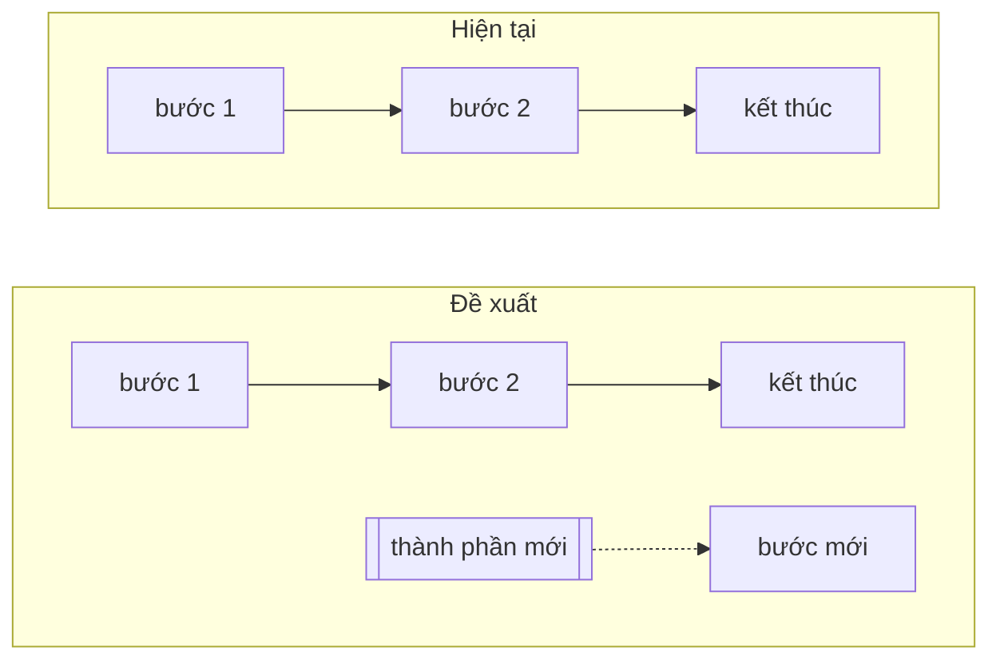

# Devflow · Phase 6 — Solution Design + Role Review (conditional)

Read `../delivery-dev/references/conventions.md`, `../delivery-dev/references/writing-policy.md`, `../delivery-dev/references/roles.md` and `../delivery-dev/references/supporting-artifacts.md` first.

INFOSEC routed ⇒ also `../delivery-dev/references/security.md`. SRE/DEVOPS routed, or the change touches infrastructure ⇒ also `../delivery-dev/references/devops.md`.

**In:** `understanding.md` + `investigation.md` + `impact.md` · **Out:** `07-solution.md` (+ `08-traceability.md`, `90-decisions.md`) · **State:** `SOLUTION_DESIGN → ROLE_REVIEW → TRACEABILITY`

**Gate-in (bắt buộc, trước mọi việc khác):** `~/.config/herdr-app/skills/delivery-dev/scripts/delivery-dev-gate.sh <issue> solution` — paste nguyên output vào mục `## Gate-in` đầu artifact. `GATE: FAIL` ⇒ **không chạy phase này**: xử lý dòng FAIL hoặc dừng và báo (conventions §3b). Không có khối Gate-in trong artifact = phase chưa chạy hợp lệ.

Runs when `status.md` routed it in: Complexity ≥ MEDIUM · Risk ≥ HIGH · more than one sane approach · architecture / API / DB change. Simple issues go straight from investigation to `delivery-dev-plan`.

**Đầu vào là link một comment Solution do dev đăng** ("review solution <link>") ⇒ đây là chấm, không phải tự thiết kế: dùng skill `delivery-solution-review`, không chạy phase này. **Issue đã có Solution được duyệt** (kết luận "Được code ngay" hoặc "Code được, sửa trước khi merge") ⇒ xem mục *Solution đã duyệt* bên dưới.

## Job

Decide **how the system should solve this** — separately from *which lines of code to edit*. Never jump from investigation to an implementation plan on a non-trivial issue: that hides the design decision inside a file list.

## Steps

1. Draft the solution: what changes, where, how the system then behaves.
2. Draw the flow — current vs proposed — only if the flow actually changes.
3. Give real alternatives with honest trade-offs. One option means it was not a decision; say why there is only one.
4. Recommend one, with the reason. Prefer the pattern the repo already uses (`investigation.md` §6). Size it to the real load and team, not to an imagined future: a modular monolith before microservices, a managed pay-per-use service before a cluster to operate. The same eight lenses that `delivery-solution-review` §4 layer 2 grades with apply to your own design, and so does its layer 3 (rollout, reversibility, decision records).
5. Run **ROLE_REVIEW**: each active role in `status.md` reviews the *design* (see `roles.md` output shape). Findings change the design here — that is the cheap place.
6. Log the choice in `decisions.md` (`D00x`).
7. Create `08-traceability.md` — now with a `Solution` column linking each requirement to the design element that satisfies it.
8. Set `SOLUTION_STATUS`.

Do not over-design. A solution doc for a two-line change is ceremony; that issue should not have routed this phase.

## Solution đã duyệt — đầu vào, không thiết kế lại

Issue đã có comment Solution và comment review kết luận "Được code ngay" hoặc "Code được, sửa trước khi merge" (`delivery-solution-review` §6) ⇒ thiết kế đã chốt ở đó. Phase này không dựng phương án mới:

1. Chạy Gate-in như thường.
2. `07-solution.md` dẫn permalink hai comment, chép phần chốt (thiết kế, các điểm đã chốt, các chỗ "phải sửa" còn lại) — không viết lại Alternatives, không chạy lại ROLE_REVIEW cho điểm đã chốt.
3. Điểm M "sửa trước khi merge" thành dòng trong `08-traceability.md` để `delivery-dev-review` kiểm trước PR.
4. Investigation lộ ra điều làm thiết kế đã chốt sai (code khác với điều Solution giả định, thiếu đường ghi dữ liệu…) ⇒ `NEED_SOLUTION_DECISION`, nêu bằng chứng; không tự đổi thiết kế đã duyệt.

`SOLUTION_STATUS: APPROVED` khi chép xong và không có điểm 4.

## Template

```md
# Solution Design

**TL;DR**
- <thiết kế chốt là gì, 1 câu>
- <đánh đổi chính>
- <cần duyệt gì / chặn ở đâu>

## Proposed Solution
<2–5 câu>

## Flow

**Vẽ theo bảng sơ đồ bắt buộc ở writing-policy §7b; sơ đồ thay đoạn văn.** Luôn có `flowchart` hai subgraph Hiện tại ⇢ Đề xuất. Thêm `sequenceDiagram` khi luồng gọi mới hoặc đổi đi qua ≥ 3 thành phần hoặc ghi nhiều bảng trong một transaction, `erDiagram` khi đổi bảng / cột (đánh dấu `NEW`), `stateDiagram-v2` khi đổi trạng thái.



Nét đứt = phần chưa tồn tại. Nhiều hơn 12 node ⇒ đang vẽ quá rộng, thu hẹp lại.

## Components Affected
- ...

## Why
- <lý do cụ thể, dẫn evidence hoặc pattern có sẵn>

## Alternatives

### Option A — <name>
Pros: ...
Cons: ...

### Option B — <name>
Pros: ...
Cons: ...

## Recommendation
Option A. Vì ...

## Risks
- ...

## Security Considerations
<threat model gọn theo security.md: attacker là ai · muốn gì · vào bằng đường nào · trust boundary nào bị đụng>

## Infrastructure / Deploy Considerations
<khi có IaC: resource nào đổi, có resource stateful nào bị replace không, rollback thật sự khôi phục được gì — theo devops.md>
<chi phí: tiền tháng ước tính mỗi môi trường (nguồn giá + ngày tra), công vận hành, vì sao chọn dịch vụ này thay vì dịch vụ nhẹ hơn>

## Performance Considerations
## Backward Compatibility
<chỉ giữ mục có nội dung thật>

## Role Review

### SA
- ...

### INFOSEC
- [H] `path:line` — ... → fix ...

### DBA
- ...

## Decision
<chốt gì, hoặc: chờ human approval — xem Gate>

---

SOLUTION_STATUS: APPROVED | NEED_SOLUTION_DECISION | DRAFT
```

## G3 — Solution Gate (architecture decision)

`NEED_SOLUTION_DECISION` — stop and ask the developer — when the choice materially affects:

architecture · database · API contract · payment · security · concurrency · data integrity · production behavior · significant performance · breaking change.

Present it as a decision, not an essay:

```text
Cần chốt:

Option A — retry ở `PaymentClient`
+ Dùng chung cho mọi caller
− Phải thêm idempotency key, đổi contract với Payment API

Option B — retry ở `PaymentService`
+ Không đụng contract
− Service khác gọi client trực tiếp sẽ không có retry

Đề xuất: A. Vì `OrderService` cũng sắp cần retry.

Rủi ro của A: duplicate payment nếu external API không idempotent — chưa xác nhận (UNKNOWN).
```

Then wait. A high-risk design is never self-approved.

## Traceability

Create `08-traceability.md` from `supporting-artifacts.md`, extended:

```md
| ID | Requirement | Solution | Code | Test | Verification | Status |
|---|---|---|---|---|---|---|
| R1 | AC-1 retry khi timeout | RetryPolicy ở PaymentClient | — | — | — | PENDING |
```

`Code` / `Test` land in `delivery-dev-implement`, `Verification` in `delivery-dev-verify`.

## Gate Out

`SOLUTION_STATUS: APPROVED` (self-approved only for non-material designs, otherwise developer-approved) + traceability created → continue to `delivery-dev-plan`.

## Report

```text
Solution: retry ở `PaymentClient` (Option A).

- INFOSEC: cần idempotency key, nếu không có risk duplicate payment.
- DBA: không đụng schema.
- Chưa xác nhận Payment API có hỗ trợ idempotency key → UNKNOWN, blocking.

Cần bạn chốt Option A hay B trước khi sang plan.
```
