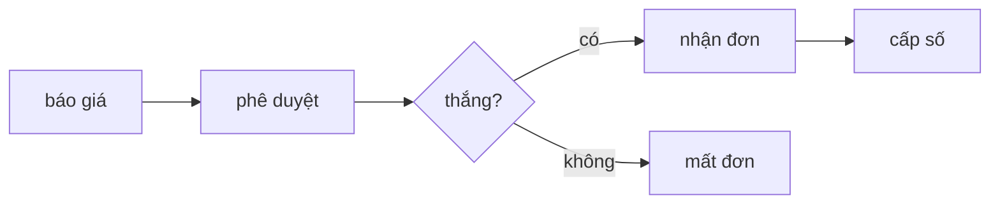

# Devflow · Phase 4 — Understanding

Read `../delivery-dev/references/conventions.md` and `../delivery-dev/references/writing-policy.md` first.

**In:** `original.md` + `context.md` · **Out:** `SoraVaults/<project>/issue <n>/03-understanding.md` · **State:** `CLASSIFIED → UNDERSTANDING → UNDERSTANDING_GATE`

**Gate-in (bắt buộc, trước mọi việc khác):** `~/.config/herdr-app/skills/delivery-dev/scripts/delivery-dev-gate.sh <issue> understand` — paste nguyên output vào mục `## Gate-in` đầu artifact. `GATE: FAIL` ⇒ **không chạy phase này**: xử lý dòng FAIL hoặc dừng và báo (conventions §3b). Không có khối Gate-in trong artifact = phase chưa chạy hợp lệ.

## Job

Make the developer understand **what must be done and why** — in Vietnamese. This is not a literal translation, and the translation never becomes the authoritative requirement.

This file is about **this issue only**. Project rules, architecture and conventions live in `01-context.md`; cite them, do not restate them. Test: xoá issue này đi mà câu đó vẫn đúng ⇒ nó thuộc `01-context.md`.

**Không để tiếng Nhật trần trong prose.** Domain term giữ nguyên gốc chỉ khi nó là nhãn/tên màn hình/tên 帳票/cột DB — tiếng Việt dẫn, nguyên gốc để trong ngoặc làm nhãn ở lần đầu xuất hiện (bỏ nhãn các lần sau): `phiếu liên lạc đơn hàng (受注連絡票)`. Bảng thuật ngữ đầy đủ ở `01-context.md` §Glossary. Chi tiết: `writing-policy.md` §8.

Missing gate input: `original.md` absent ⇒ run `delivery-dev-intake`; `context.md` absent ⇒ run `delivery-dev-context` (project constraints change how the issue reads).

## Steps

1. Read `original.md` in full, plus the comments, plus the constraints in `context.md`.
2. **Classify** every statement in the issue (see below) before writing anything else.
3. Write `03-understanding.md` using the template, in natural, plain Vietnamese.
4. Extract AC. AC stated in the issue ⇒ carry them over faithfully. AC not stated ⇒ derive them **only** from what the issue actually says, and mark each `(derived — cần confirm)`.
5. List every ambiguity as `UNKNOWN`. Do not fill a hole with a plausible guess.
6. Gloss any technical term that matters for implementation, once (conventions §7). A concept worth keeping goes to `learnings.md`.
7. Evaluate the Understanding Gate and write the status line.

## Requirement Classification (mandatory)

Do not confuse a suggestion from the issue with a mandatory requirement.

| Kind | Question it answers | Binding? |
|---|---|---|
| **Business Requirement** | What outcome does the business need? | Yes |
| **Technical Requirement** | What must the system technically do/guarantee? | Yes |
| **Constraint** | What limits the solution (deadline, compat, platform, perf budget)? | Yes |
| **Acceptance Criteria** | How do we prove it is done? | Yes — the contract |
| **Implementation Detail / Suggestion** | One possible way to do it | **No** — unless the issue says it is required |

```text
Requirement:    "Users must not see duplicate orders."
Implementation: "Use Redis lock."     ← đề xuất, không phải yêu cầu
```

Keep the distinction visible in the artifact. An implementation suggestion is recorded as a suggestion, evaluated in `delivery-dev-plan`, and — if adopted or rejected — logged in `decisions.md`.

## Template

```md
# Understanding

## 1. Issue

- ID: #<number>
- Title: <original title>
- Source language: ja | en
- URL: <url>

## 2. Tôi hiểu task này là gì?

<giải thích tiếng Việt đơn giản>

## 3. Tại sao cần làm?

<lý do nghiệp vụ hoặc kỹ thuật>

## 4. Requirement Classification

### Business Requirements
- ...

### Technical Requirements
- ...

### Constraints
- ... (kèm nguồn: issue / context.md)

### Implementation Suggestions (NOT requirements)
- "<gợi ý trong issue>" — đánh giá ở plan.md

## 5. Acceptance Criteria

| ID | Criteria | Testable? | Oracle — kiểm bằng gì |
|---|---|---|---|
| AC-1 | ... | YES | `pytest` case timeout 5.1s |
| AC-2 | ... (derived — cần confirm) | NO — "nhanh hơn" không đo được | cần ngưỡng cụ thể |

## 6. Expected Behavior

Nghiệp vụ có từ 3 bước trở lên, hoặc có trạng thái ⇒ **vẽ** (`flowchart` theo làn vai trò cho luồng, `stateDiagram-v2` cho trạng thái, sequence mức nghiệp vụ khi từ 3 bên trao tay nhau), đừng tả. Khuôn và quy tắc: `../delivery-start/references/so-do.md`.



### Current Behavior
...

### Expected Behavior
...

## 7. Evidence

FACT: <quote từ issue / dòng trong context.md>
INFERENCE: ...
ASSUMPTION: ... (confirm bằng cách nào)
UNKNOWN: ... (có blocking không)

## 8. Unknown / Ambiguous

- UNKNOWN: ...

## 9. Câu hỏi cần clarification  (song ngữ)

Mỗi câu hỏi viết **hai bản**: tiếng Việt để bạn hiểu mình đang hỏi gì, và bản gửi đi.

### Q1
- **VI:** Khi nhận đơn (受注) bị huỷ sau khi đã cấp số (採番), số đó có được dùng lại không?
- **EN:** When an order is cancelled after its number has been issued, is that number reused or retired?
- *(JP — chỉ thêm khi issue và team dùng tiếng Nhật; bản này mới là bản post lên issue)*

Bản tiếng Anh là mặc định để gửi. Repo/team dùng tiếng Nhật ⇒ thêm bản JP và post bản JP; bản VI **không bao giờ** post lên issue, nó dành cho bạn.

## 10. My Understanding

<một đoạn ngắn tiếng Việt, như đang giải thích issue cho một dev khác>

---

UNDERSTANDING_STATUS: READY | NEED_CLARIFICATION | NO_CHANGE
```

## Đường thoát: issue không cần code

Not every issue ends in a change. When reading `original.md` + `context.md` already shows one of these, stop the workflow instead of manufacturing work (the same exit exists at the end of `delivery-dev-investigate`, for when only the code or a reproduction attempt reveals it):

| Outcome | Nghĩa là |
|---|---|
| `DUPLICATE` | đã có issue/PR khác xử lý — dẫn link |
| `NOT_A_BUG` | hành vi hiện tại là đúng theo spec — chỉ ra spec/code chứng minh |
| `CANNOT_REPRODUCE` | đã thử, không tái hiện — thường chỉ biết ở `delivery-dev-investigate` (baseline); ở phase này chỉ dùng khi issue tự nói vậy |
| `WONTFIX` | đúng là vấn đề nhưng không đáng sửa ở đây — nêu lý do |
| `NEEDS_PRODUCT_DECISION` | không phải câu hỏi kỹ thuật — cần PO/BA quyết |

Write the finding + evidence into `understanding.md`, put `Outcome: <DUPLICATE|NOT_A_BUG|…>` on the line above the token, set `UNDERSTANDING_STATUS: NO_CHANGE` (not `NEED_CLARIFICATION` — that one resumes after an answer; this one is terminal), draft the comment for the issue in the issue's own language, and **stop**. Closing the issue is the developer's action, never yours.

An outcome like this is a valid result, not a failure — a workflow that can only say "yes, let's build it" is not doing its job.

## G1 — Understanding Gate

*Do we understand what the issue actually requires?* Print this checklist with its result:

```text
[ ] Expected behavior understood
[ ] Acceptance Criteria identified
[ ] Mỗi AC testable — có oracle cụ thể   (STLC 1)
[ ] Constraints identified
[ ] Ambiguities identified
[ ] No critical UNKNOWN
```

**Testability là một phần của gate này.** Một AC không nói được "kiểm bằng gì" thì không phải AC — nó là mong muốn. `AC-2: hệ thống phải nhanh hơn` ⇒ hỏi ngưỡng (p95 bao nhiêu, đo ở đâu) trước khi qua gate; đừng để phase test tự bịa ngưỡng.

`NEED_CLARIFICATION` when any of these holds:

- Acceptance Criteria are unclear or absent and cannot be derived safely.
- Expected behavior is ambiguous.
- More than one reasonable interpretation exists.
- An important business rule is missing.
- The issue conflicts with existing requirements, current behavior, or `context.md`.
- A technical decision materially changes behavior.

**Never silently pick an interpretation.** When blocked:

1. Explain the ambiguity in Vietnamese.
2. List the possible interpretations.
3. Recommend the safest one, with the reason.
4. Draft a short question **bilingual VI/EN** (thêm JP khi team dùng tiếng Nhật) — bản VI để bạn hiểu, bản kia để post lên issue.

Then STOP. Ambiguous business logic is not implemented without approval.

**Who answers decides where the question goes.** A rule the team's PO can settle → tag the PO on the issue. A rule only the customer can settle (the spec is silent or contradicts itself on strict business behaviour) → draft a Clarification with `delivery-write-issue`: deadline, and what the team will do if the deadline passes; link it from this issue and resume when it is answered. The same hand-off applies to the `NEEDS_PRODUCT_DECISION` exit above.

`READY` ⇒ continue to the next routed phase — `delivery-dev-investigate`.

## Report

Phase summary: what the task is (2–3 lines Vietnamese), requirement vs suggestion split, AC count, the `UNKNOWN` list, gate checklist result, next step. Do not paste the whole file.
