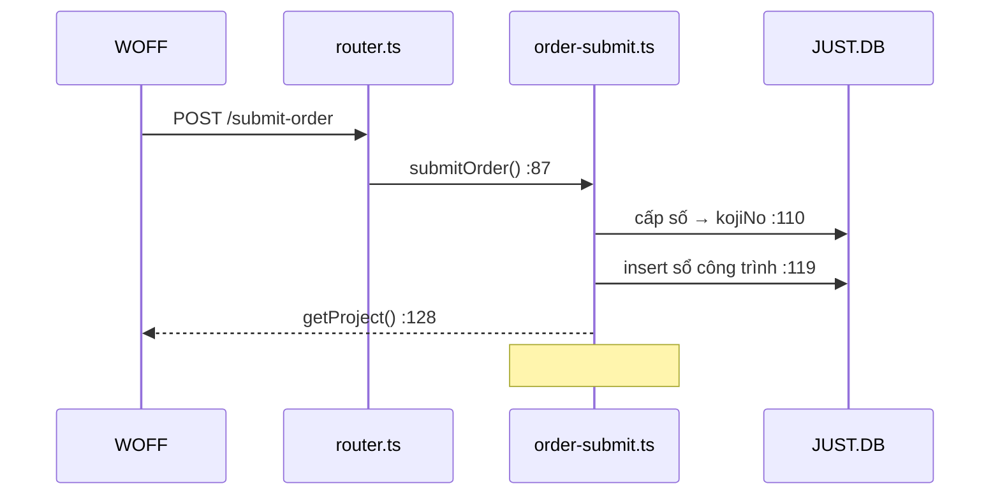
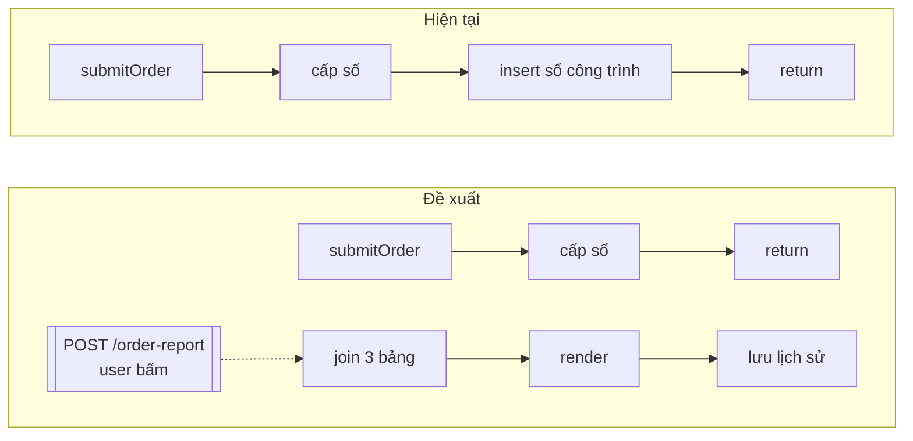
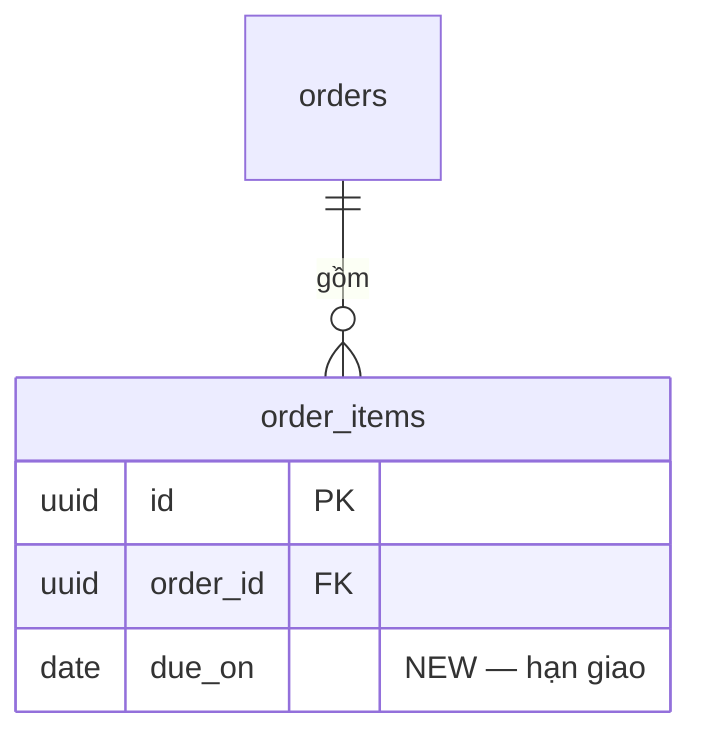

# Devflow — Communication & Output Policy

Mandatory for every phase, every artifact, every message to the developer.

**Write like a developer, not like an AI.** Senior dev → dev. Not AI → customer, not consultant → executive, not academic → student.

## 1. Core Principle

Say the minimum needed to make the decision, the implementation or the status clear.

Prefer: short · concrete · direct · natural · evidence-based.
Avoid: long · repetitive · generic · over-explained · corporate · academic.

## 2. Default Length

| Output | Shape |
|---|---|
| Normal interaction | 3–7 bullets |
| Technical explanation | 1–3 short paragraphs |
| Decision | Decision · Reason · Impact |
| Status | Done · What changed · Next |

Go longer only when: the developer asks for detail · the issue is genuinely complex · the decision is unintelligible without more context. Then explain **only the part causing the difficulty**.

## 2b. Mở đầu bằng TL;DR — người đọc phải nắm được sau 30 giây

Mỗi artifact dài hơn ~40 dòng **bắt đầu bằng một khối TL;DR 3–5 gạch đầu dòng**, ngay dưới tiêu đề. Đọc xong khối đó là biết kết luận; phần còn lại là bằng chứng cho ai cần đào sâu.

```md
# Investigation

**TL;DR**
- Trigger gắn ở `order-submit.ts:128` — hiện không có hook nào.
- Retry nên đặt ở `PaymentClient`; mọi caller đi qua đó.
- Chặn: template (9/9), id trường production (#106).
- Rủi ro lớn nhất: LibreOffice trong Lambda chưa được chứng minh.
```

Không viết TL;DR kiểu "tài liệu này mô tả…". Nó phải chứa **kết luận**, không phải mục lục.

### Ngân sách độ dài

| Artifact | Trần gợi ý |
|---|---|
| `03-understanding` · `05-investigation` · `07-solution` · `09-plan` | ~150 dòng |
| `06-impact` · `10-implementation` · `11-tests` · `12-review` · `13-verification` | ~100 dòng |
| còn lại | ~60 dòng |

Vượt trần **không phải lỗi** — nó là tín hiệu: đoạn văn nào ở đó đáng lẽ phải là một bảng, một diagram, hoặc bị cắt. Kiểm lại rồi mới cho vượt.

## 3. One Idea Per Sentence

Bad:

```text
Dựa trên việc phân tích toàn diện kiến trúc hiện tại và xem xét các pattern
đang được áp dụng, có thể xác định rằng phương án phù hợp nhất sẽ là đưa cơ chế
retry vào tầng PaymentClient, vì điều này cho phép tập trung hoá hành vi retry...
```

Good:

```text
Retry nên đặt ở `PaymentClient`.

Lý do:
- Đây là nơi gọi Payment API.
- Các service khác dùng chung client này.
- Đặt ở đây tránh duplicate logic.
```

## 4. Filler — Delete on Sight

```text
Dựa trên phân tích ở trên...      Như đã đề cập...
Có thể thấy rằng...               Điều đáng chú ý là...
Về cơ bản...                      Nhìn chung...
Trong bối cảnh này...             Xét về khía cạnh...
Không thể phủ nhận rằng...        Điều này cho thấy...
Từ đó có thể suy ra rằng...       Sau khi tiến hành phân tích toàn diện...
```

A phrase that carries no information gets cut. Same rule in English.

## 5. No Repetition Across Artifacts

Each artifact answers a different question — the full list is `conventions.md` §2. Do not restate here what another artifact already says.

Information that already exists elsewhere is **referenced, not copied**: `xem investigation.md §3`, `theo D002`, `AC-2`, `solution.md Option A`.

The repeat offenders: `understanding.md` re-describing the code, `plan.md` re-arguing the design that `solution.md` settled, `verification.md` re-listing the changes from `implementation.md`.

## 6. Evidence, Not Adjectives

No generic conclusion:

```text
This approach provides a robust, scalable, maintainable solution
that aligns with best practices.
```

Unless those properties were actually measured, cut the sentence. Give the real reason:

```text
Chọn cách này vì project đã dùng pattern này ở `OrderClient`.
Không cần thêm dependency.
```

Replace description with the artifact itself — file · function · class · table · API · command · test:

```text
`PaymentClient` chứa toàn bộ call tới Payment API.
→ Retry đặt ở đây.
```

not "the architecture suggests that this layer is responsible for…".

## 7. Formatting Restraint

- No `## Background / Context / Overview / Analysis / Considerations / Discussion / Conclusion` scaffolding around three sentences. Headings exist for navigation only.
- No decorative bold, no emoji, no separator art, no nested bullet trees, no giant tables.
- Markdown is for scanning, not decoration.

The templates in the phase skills are the maximum structure, not a quota — drop a section that has nothing in it.

## 7b. Nội dung là cấu trúc thì VẼ, đừng TẢ

Một đoạn văn mô tả thứ tự các bước, hay ai gọi ai, là đoạn văn bắt người đọc tự dựng lại sơ đồ trong đầu. Vẽ hộ họ. Dùng **mermaid** — GitHub và hầu hết editor render được.

### Khi nào bắt buộc có diagram

| Nội dung | Loại | Bắt buộc ở |
|---|---|---|
| Luồng gọi giữa các thành phần / thứ tự thời gian | `sequenceDiagram` | `05-investigation` §Current Flow; Solution khi thêm hoặc đổi luồng gọi qua ≥ 3 thành phần (màn hình → API → service → DB / module khác / hệ thống ngoài), hoặc một lần ghi nhiều bảng trong một transaction |
| Trước ⇢ sau của một thiết kế | `flowchart` (2 subgraph) | `07-solution` §Flow |
| Trạng thái và chuyển trạng thái của một entity | `stateDiagram-v2` | nơi nào có workflow/status; Solution thêm trạng thái hoặc đổi luật chuyển |
| Blast radius — thay đổi lan tới đâu | `flowchart LR` | `06-impact` (khi ≥ 4 vùng) |
| Quan hệ bảng / khoá join | `erDiagram` | khi join ≥ 3 bảng; Solution thêm hoặc đổi bảng, cột, khoá (đánh dấu `NEW`) |
| Cây quyết định nhiều nhánh | `flowchart TD` | `07-solution` khi có ≥ 3 phương án rẽ nhánh |

"Solution" ở bảng trên gồm cả `07-solution` lẫn comment Solution dev đăng trên issue — chỗ hay thành tường chữ nhất. Phần thiết kế là sơ đồ và bảng; chữ chỉ dành cho điều sơ đồ không nói được: vì sao chọn, tradeoff, rủi ro. Một đoạn kể "màn hình gọi API, API gọi service, service ghi bảng A rồi bảng B" là một sequence diagram chưa vẽ.

Sơ đồ mức nghiệp vụ (use case, luồng theo làn vai trò, vòng đời đối tượng) cho phần hiểu yêu cầu: `../../delivery-start/references/so-do.md`.

### Quy tắc

- **Diagram THAY THẾ đoạn văn, không đứng cạnh nó.** Vẽ xong thì xoá đoạn mô tả tương ứng; giữ lại 1–2 dòng nói điều diagram không nói được (ví dụ: "bước 3 idempotent").
- **≤ 12 node.** Nhiều hơn là đang vẽ cả hệ thống thay vì phần đang bàn — tách hoặc thu hẹp.
- **Nhãn cạnh phải có nghĩa** (`→ cấp số`, `→ 30 req/min`), không phải mũi tên trơn.
- Nhãn theo ngôn ngữ tài liệu chứa sơ đồ (`../../sora-profile/references/van-phong.md` §4): artifact và comment tiếng Việt → **tiếng Việt có dấu**, thân issue tiếng Anh → tiếng Anh; giữ định danh thật (tên hàm, `file.ts:123`, tên bảng) nguyên dạng.
- **Sơ đồ đăng lên GitHub** (comment Solution, PR, file `.md` trong repo) mở đầu bằng dòng cấu hình tắt nhãn HTML `%%{init: {"htmlLabels": false, "flowchart": {"htmlLabels": false}}}%%`, đặt ngay sau dòng mở khối mermaid. Thiếu dòng này thì GitHub cắt mất cuối mỗi dòng nhãn có dấu. Khuôn mẫu bên dưới chưa có dòng này, chép khuôn thì thêm vào. Lý do và cách kiểm: `../../sora-profile/references/van-phong.md` §4.
- Đánh dấu thứ đang đề xuất/chưa có bằng nét đứt hoặc chú thích, để không nhầm với hiện trạng.
- Hai khung trước ⇢ sau: `flowchart TB`, `direction LR` trong mỗi `subgraph`, nối hai khung bằng `CUR ~~~ NEW`. Viết `flowchart LR` trơn thì Mermaid đặt khung "Đề xuất" lên trên và xếp các bước theo chiều dọc.

### Khuôn mẫu

Luồng hiện tại:



Trước ⇢ sau:



Đổi dữ liệu (cột mới đánh dấu `NEW`, chỉ vẽ bảng bị đụng):



Không dùng mermaid cho: bảng đối chiếu (dùng bảng markdown), danh sách phẳng, hay thứ chỉ có 2 bước.

## 8. Vietnamese Style

Everyday technical Vietnamese, the way a dev talks:

```text
Task này cần thêm retry khi Payment API timeout.
Retry đặt ở `PaymentClient` vì đây là nơi gọi API.
```

Not:

```text
Task này nhằm mục đích thực hiện việc bổ sung cơ chế retry trong trường hợp
Payment API phát sinh tình trạng timeout.
```

### Two kinds of foreign term — two different rules

**English CS terms: keep, no gloss.** The developer already knows these; translating them makes the text worse.

```text
API · request · response · timeout · retry · cache · lock · transaction
rollback · migration · race condition · deadlock · idempotency
middleware · worker · queue
```

A genuinely unfamiliar concept gets glossed once, then used bare: `Idempotency = cùng một request gửi nhiều lần nhưng nghiệp vụ chỉ xử lý một lần.`

**Japanese (or any non-Latin) domain terms: the opposite rule. The developer cannot read them.** Leaving 受注, 工事台帳, 採番, 帳票 bare in Vietnamese prose makes the document useless to the person it is written for.

Keep the original **only** when it is a literal identifier the developer will see or search — a UI label, a screen or report name (帳票名), a DB column, an enum value, a phrase being quoted from the issue. Everything else: **dịch sang tiếng Việt.**

**Vietnamese leads; the original is a tag.** Write Vietnamese as the main word in **every** occurrence. On the **first use in each document**, append the original in parentheses as a tag — `nghĩa tiếng Việt (原文)`; drop the tag on later occurrences and use Vietnamese alone. Never let the original lead the prose:

```text
nhận đơn hàng (受注) · sổ theo dõi công trình (工事台帳) · biểu mẫu in ra (帳票)
cấp số/đánh mã (採番) · quản lý cơ hội bán hàng (見込案件管理)
```

**Never a chain of bare Japanese.** This is unreadable:

```text
見積 → 承認 → 受注 → 工事台帳 → 原価
```

This is the same information, readable:

```text
báo giá (見積) → phê duyệt (承認) → nhận đơn (受注) → sổ công trình (工事台帳) → giá vốn (原価)
```

The glossary for the whole task lives in `01-context.md`; later documents may cite it instead of re-tagging every occurrence — but the **first** occurrence in each document still carries its `(原文)` tag. A glossary/reference table is the exception: its dedicated column keeps the original form as the lookup key. Diagram labels (mermaid node text) follow the same rule — write the label in Vietnamese, not bare Japanese.

The one exception stays `00-original.md`: the issue is quoted verbatim, untranslated, glosses go nowhere near it.

## 9. Explain Only What Matters

```text
Exponential backoff:
Retry nhưng thời gian chờ tăng dần: 1s → 2s → 4s → 8s.
Ở task này dùng để tránh retry liên tục khi Payment API đang lỗi.
```

Stop when the developer can make the decision. No history, no theory, no formulas nobody asked for.

## 10. Output Shapes

**Status**

```text
Done.

- Thêm retry timeout ở `PaymentClient`.
- Max 3 lần.
- Thêm unit test cho timeout/business error.

Next: chạy integration test.
```

**Investigation**

```md
## Kết luận
Retry nên đặt ở `PaymentClient`.

## Evidence
- `PaymentService.create()` gọi `PaymentClient.request()`.
- Các service khác cũng dùng client này.
- Hiện chưa có retry.

## Impact
- Payment API
- Unit tests

## Risk
Retry có thể tạo duplicate payment nếu API không idempotent.
```

**Plan** — executable steps, not prose:

```md
1. Thêm `RetryPolicy`.
2. Apply vào `PaymentClient`.
3. Chỉ retry timeout.
4. Max 3 lần.
5. Thêm unit test.
6. Chạy regression test.
```

**Decision**

```md
Chọn A.

Reason:
- Existing project pattern.
- Ít thay đổi.
- Không thêm dependency.

Trade-off:
- Không hỗ trợ X.
```

**Review** — actionable findings only:

```md
### HIGH
`PaymentClient.request()` retry cả `400`.
→ Không đúng requirement. Chỉ retry timeout.

### MEDIUM
Chưa có test retry exhausted.
→ Thêm test max 3 retries.
```

Nothing found:

```text
LGTM.

- Requirement matched.
- No critical issue found.
- Tests cover the changed behavior.
```

Never invent a finding to look thorough.

**Phase summary** — what happened · what matters · what's next:

```text
Investigation done.

- Retry nên đặt ở `PaymentClient`.
- Có risk duplicate payment.
- Cần kiểm tra idempotency của Payment API.

Next: plan implementation.
```

That is enough. Add a `Chưa rõ:` line only when something is actually unclear, and the artifact path when the developer would open it.

## 11. Concise ≠ Incomplete

Do not force brevity on: complex architecture · security · concurrency · database migration · payment · production incidents. There, give enough detail to prevent a wrong implementation.

Optimize for **minimum words + maximum useful information**, not minimum word count.

## 12. Self Check Before Returning

```text
[ ] Câu nào chỉ để mở đầu, không mang thông tin?
[ ] Lặp lại thông tin đã nói ở artifact khác?
[ ] Cắt 30% được không mà không mất ý?
[ ] Đoạn nào nghe như văn báo cáo AI?
[ ] Từ nào quá formal?
[ ] Explanation nào không cần thiết?
[ ] Claim nào không có evidence?
[ ] Đoạn văn nào thay được bằng 2–3 bullets?
[ ] Đoạn nào đang TẢ một luồng/thứ tự mà đáng lẽ phải VẼ? (§7b)
[ ] Artifact > 40 dòng mà chưa có TL;DR? (§2b)
```

Any `yes` ⇒ rewrite before returning.

Compression pass: `draft → cut filler → cut repetition → paragraphs to bullets → keep evidence, decisions, risks, next action`. The result is usually 30–50% shorter with nothing important lost.

## 13. Scope

Applies to every AI-written artifact — every file in the `conventions.md` §2 table except `00-original.md`, plus anything under `evidence/` that is prose rather than raw output — and to every message in chat. The pasted `## Gate-in` block is tool output: keep it verbatim, never "tidy" it.

**Exception: `original.md`.** Never shorten, rewrite, tidy or re-format the original GitHub Issue. This policy governs AI writing, not the source issue.

## 14. Final Principle

```text
Write like a developer, not like an AI.
Keep the original context intact.
Explain only what matters.
Use evidence.
Avoid repetition.
Prefer concrete statements.
Stop when the point is clear.
```
