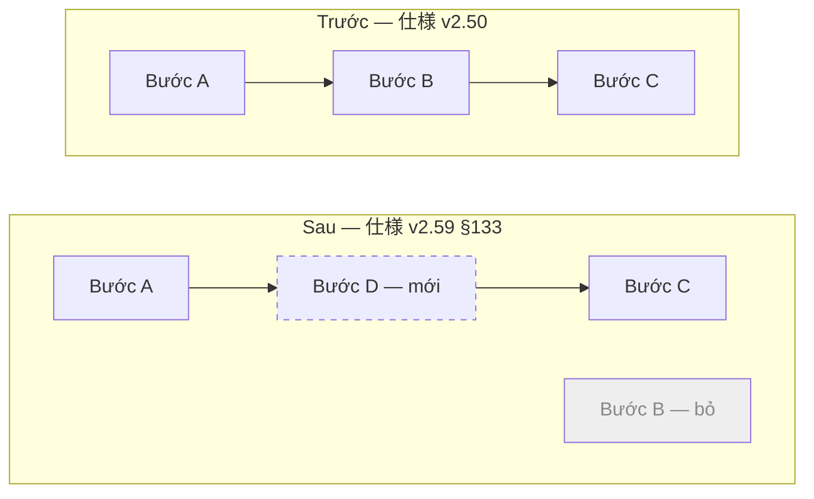

# delivery-spec-sync/references/mau-bao-cao.md

---

# Mẫu báo cáo đối soát spec

Báo cáo này là đầu ra chính của skill. Người đọc là **PoC + team ở buổi Grooming (T6 tuần 2)**; phần
"đang chờ Malme" đi thẳng vào **báo cáo thứ 6** gửi Malme.

Nguyên tắc trình bày: **kết luận trước, bằng chứng sau**; mỗi dòng đều dẫn được về § hoặc mã FR.
Thay đổi nào đổi một luồng nghiệp vụ hoặc vòng đời trạng thái thì có sơ đồ trước ⇢ sau ở §2 (khuôn và quy tắc: `../../delivery-start/references/so-do.md`; nét đứt = bước mới, nền xám = bước bỏ). Không thay đổi nào chạm luồng thì bỏ khối đó.

---

## Mẫu đầy đủ

````markdown
# Đối soát spec — {Dự án} — {DD/MM/YYYY}

## 0. Kết luận trong 3 dòng

- Canon PM repo đang **đi trước bản ghim {n} version / {m} commit** ({SHA_ghim} → {SHA_head}).
- **{a} issue lỗi thời · {b} issue phải huỷ · {c} việc phát sinh chưa có issue · {d} issue gỡ chặn.**
- Đề xuất: {nhận vào sprint kế / đổi chỗ trong sprint này / chờ 変更通知 được gửi}.

## 1. Tình trạng version

| | Bản ghim (repo dev) | Canon (PM repo) | Lệch |
|---|---|---|---|
| 要件定義書 | v3.40 | v3.48 | 8 bản |
| 機能仕様書 | v2.42 | v2.50 | 8 bản |
| SHA | `8d25a1aa` (13/09) | `3b3b1ca1` (16/09) | 55 commit · 97 file |

**変更通知 liên quan:**

| Bản | § | Ngày gửi | Trạng thái | Ràng buộc? |
|---|---|---|---|---|
| v7.0 | §96–§106 | 16/09/2026 | đã gửi (đóng băng) | ❌ chưa — chưa sync về bản ghim |
| v8.2 | §107–§111 | — | **chưa gửi** | ❌ chưa |

> 🔴 Chưa sync = **chưa ràng buộc**. Không sửa issue đang trong sprint, không code theo.

## 2. Thay đổi mới (theo §)

| § | Loại | Nội dung (1 dòng) | Mã | Ưu tiên |
|---|---|---|---|---|
| §109 | 🧮 Logic | 権限が発生する操作 = 6 thao tác (đè 25 mục §51/§93) | FR-016 · §3.7 | 🔴 |
| §111 | 📘 Rút scope | 週間受注情報 (FR-055) không làm ở Phase 1 | FR-055 · T-407 | 🔴 |

**Luồng đổi — §133** (mỗi thay đổi chạm luồng một sơ đồ):



## 3. Ảnh hưởng tới backlog

### 3.1 🔴 Rổ B — phải huỷ ({b} issue)

| Issue | Tiêu đề | Căn cứ | Trạng thái hiện tại | Đề xuất |
|---|---|---|---|---|
| #211 | 週間受注情報のフォーム入力 | §111 — `#211／#212 は実装不要` | `Todo` | `Canceled` + comment |
| #212 | 週間受注情報の PDF 自動生成 | §111 | `Todo` | `Canceled` + comment |

### 3.2 🟡 Rổ A — lỗi thời spec ({a} issue)

| Issue | Version issue dựa vào | § đã đổi | Phần bị ảnh hưởng | Đề xuất |
|---|---|---|---|---|
| #4xx | 要件 v3.12 / 仕様 v2.14 | §109 | AC 2, 4 · bảng `case_permissions` | cập nhật AC sau khi PR sync merge |

### 3.3 🆕 Rổ C — phát sinh chưa có issue ({c} việc)

| § | Việc cần làm | Loại issue đề xuất | Ước lượng thô |
|---|---|---|---|
| §108 | Seed 部門マスタ theo tên chính thức mới | `Task` (Sora bóc) | 0,5 ngày |

> Yêu cầu nghiệp vụ mới thì **Malme tạo `Requirement`** — Sora không tự tạo.

### 3.4 ✅ Rổ D — gỡ chặn ({d} issue)

| Issue | Đang chặn vì | Đã chốt | Đề xuất |
|---|---|---|---|
| #4yy | Q47 `【要確定・着手不可】` | §110 — số thiết kế được tái sử dụng | `Blocked → Todo`, xoá `Waiting on` |

### 3.5 Rổ E — không bị chạm: {e} issue.

## 4. Nợ kỹ thuật phát sinh

| Vấn đề | Chi tiết | Đề xuất |
|---|---|---|
| Code đã xây cho tính năng bị rút | {vd #151 master 書類番号} | Task "gỡ hay để lại" + ước lượng, đưa ra cổng thay đổi |
| Audit event mất writer | {liệt kê} | Giữ hàng trong enum, đổi ghi chú (10.2) |
| Cột CSV mất dữ liệu | {liệt kê} | Giữ cột, xuất trống (Q5) |

## 5. Điểm mơ hồ → cần hỏi Malme

| # | Câu hỏi | Đang chặn issue | Hạn trả lời (SLA 3 ngày làm việc) |
|---|---|---|---|
| 1 | {câu hỏi cụ thể, một câu một ý} | #… | {DD/MM} |

→ Gom lại gửi **một đợt** ở buổi Grooming (T6 tuần 2), rồi gửi Q&A cho Malme vào T2 tuần kế — không hỏi rải rác.

## 6. Việc cập nhật tài liệu

| Nơi | Việc | Trạng thái |
|---|---|---|
| Repo dev `docs/requirements/source/` | PR sync v3.48 / v2.50 | ⏳ chờ khe giữa 2 sprint |
| Wiki `9.{N}` | trang changelog đợt này | ⏳ |
| Wiki trang nội dung | `2` · `4.1` · `4.3` · `7.4` · `10.1` | ⏳ |
| Wiki `9.0` Sync Ledger | ghi sổ + SHA canon | ⏳ |
| Wiki `SRS` | tách đợt riêng | ⏳ |

## 7. Hành động chờ xác nhận

> Chưa thao tác gì lên GitHub / wiki. Xác nhận từng nhóm rồi tôi chạy:
>
> 1. Comment + `Canceled` cho #211, #212 — {n} thao tác
> 2. Comment "spec đã đổi" cho {…} — {n} thao tác
> 3. Tạo trang wiki `9.{N}` + patch {k} trang nội dung
> 4. Mở PR sync bản ghim (không push/merge nếu chưa được phép)
````

---

## Bản rút gọn (khi người dùng chỉ hỏi "có gì mới không")

```markdown
**{Dự án} — canon đang đi trước bản ghim {n} version ({SHA_ghim} → {SHA_head}, {m} commit).**

- 変更通知 mới: v7.0 (§96–§106, đã gửi 16/09) · v8.2 (§107–§111, chưa gửi)
- Ảnh hưởng nhanh: **{b} issue phải huỷ** (#211, #212 — §111), **{a} issue lỗi thời**, **{c} việc mới**
- Chưa sync = chưa ràng buộc → sprint đang chạy giữ nguyên bản ghim v3.40 / v2.42

Muốn tôi chạy đối soát đầy đủ + soạn hành động không?
```
