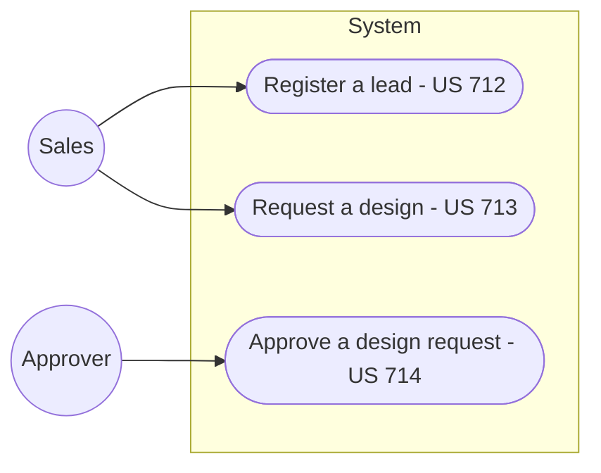
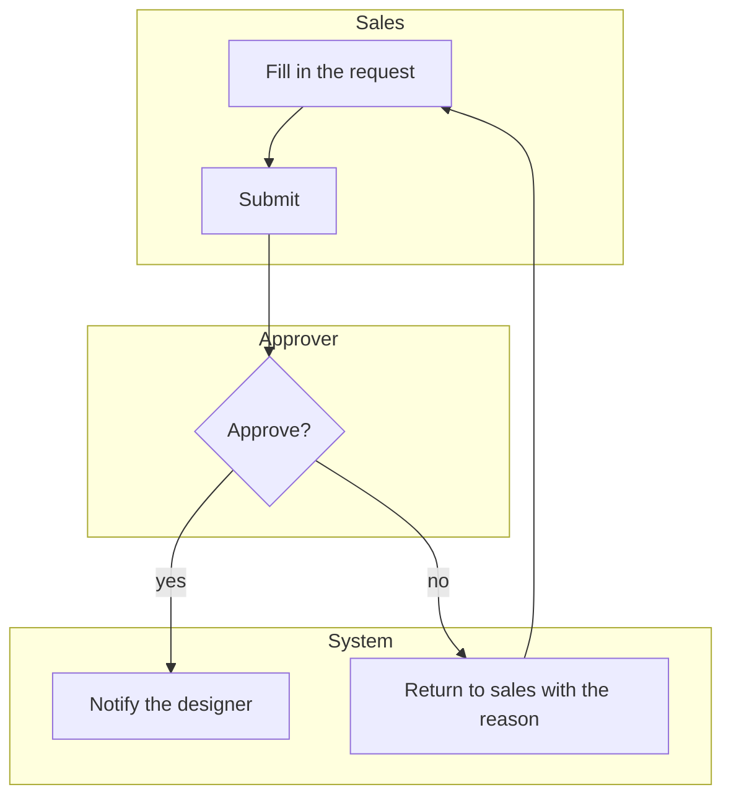
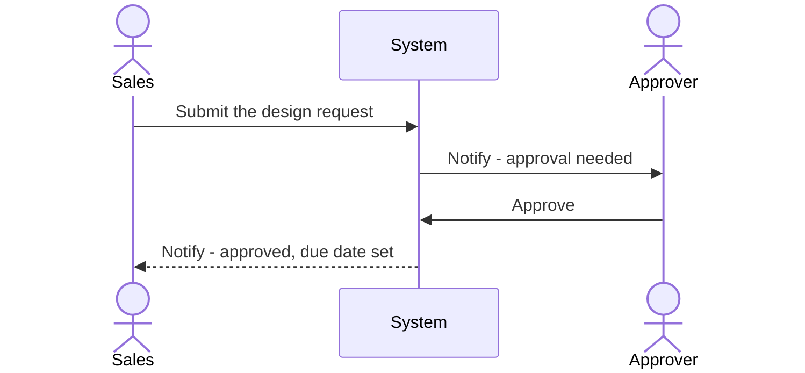
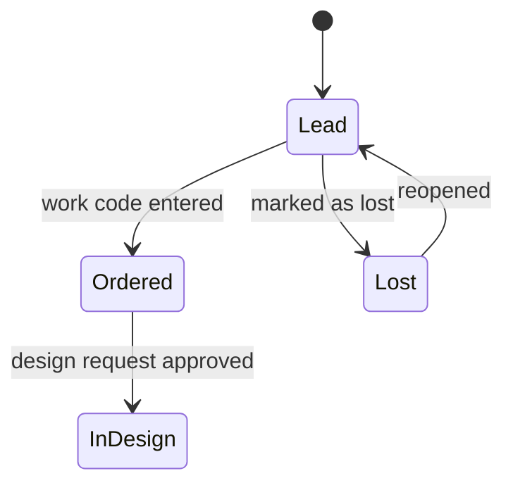
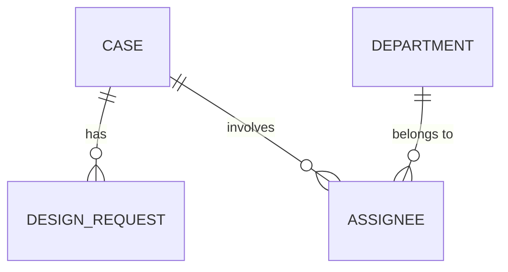
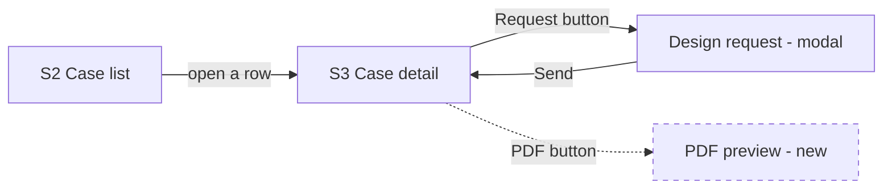
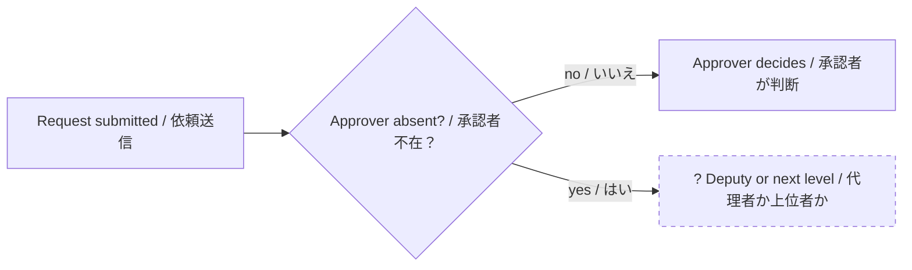

# Sơ đồ nghiệp vụ — vẽ thay tả

Dùng chung cho mọi skill delivery-* khi phân tích nghiệp vụ: rà yêu cầu của khách, viết Epic / US, soạn Clarification, đối soát đặc tả, hiểu issue trước khi code. Sơ đồ ở đây là **mức nghiệp vụ**: vai trò, bước, đối tượng nghiệp vụ, trạng thái. Không có tên module, bảng, endpoint — đó là việc của Solution, vẽ theo `../../delivery-dev/references/writing-policy.md` §7b.

Một đoạn văn kể "người bán gửi, người duyệt duyệt, hệ thống báo người thiết kế" bắt người đọc tự dựng sơ đồ trong đầu, và khách đọc bản dịch còn khó hơn. Vẽ hộ họ.

## Khi nào bắt buộc

| Nội dung | Sơ đồ | Bắt buộc ở |
|---|---|---|
| Ai dùng hệ thống để làm gì (phạm vi) | use case | Epic; rà Requirement có từ 2 vai trò trở lên |
| Các bước nghiệp vụ, rẽ nhánh, ai làm bước nào | luồng theo làn vai trò (`flowchart`, mỗi vai trò một `subgraph`) | US hay Requirement có từ 3 bước trở lên hoặc có rẽ nhánh |
| Trao tay giữa người và hệ thống theo thời gian (gửi duyệt, thông báo, trả về) | sequence mức nghiệp vụ (`actor` là vai trò, một `participant` là "System") | từ 3 bên tham gia trở lên |
| Vòng đời một đối tượng: trạng thái, chuyển, điều kiện chuyển | `stateDiagram-v2` | luật xoay quanh trạng thái |
| Đối tượng nghiệp vụ và quan hệ | ER mức khái niệm (không kiểu dữ liệu, không khoá) | Requirement đưa vào đối tượng mới |
| Màn nào mở màn nào, bằng nút gì | chuyển màn (`flowchart LR`, node là màn hình, nhãn mũi tên là nút hoặc thao tác) | US đi qua từ 2 màn hình trở lên |
| Chỗ còn phải hỏi khách | luồng đang hiểu, nhánh đang hỏi đánh `?` và viền nét đứt, nhãn song ngữ | Clarification hỏi về luồng hoặc điều kiện |
| Đặc tả đổi luồng hoặc vòng đời | hai khung trước ⇢ sau (khuôn ở `../../delivery-spec-sync/references/mau-bao-cao.md` §2) | báo cáo đối soát đặc tả, trang changelog wiki |

Không vẽ cho: danh sách phẳng, việc chỉ có 2 bước, bảng đối chiếu (dùng bảng markdown).

## Quy tắc

- **Sơ đồ thay đoạn văn, không đứng cạnh nó.** Chữ còn lại chỉ nói điều sơ đồ không nói được: vì sao, ngoại lệ, nguồn.
- Một sơ đồ một ý, tối đa khoảng 12 node. Rộng hơn thì tách theo vai trò hoặc theo giai đoạn.
- Mức nghiệp vụ: tên vai trò và đối tượng nghiệp vụ người dùng gọi hằng ngày. Thấy tên bảng hay module trong sơ đồ nghiệp vụ là đang viết Solution.
- Sơ đồ chuyển màn dùng đúng mã và tên màn hình trong sơ đồ IA / chuyển màn của dự án (toạ độ trong memory dự án); màn mới chưa có trong IA vẽ nét đứt.
- Mỗi use case trong Epic ứng với một US, ghi số US trong nhãn. Mỗi bước trong luồng của US ứng với ít nhất một quy tắc hoặc AC; bước không có AC là chỗ hổng.
- Thứ chưa có hoặc đang đề xuất: nét đứt (`-.->`, `stroke-dasharray`), để không lẫn với hiện trạng.
- **Ngôn ngữ nhãn theo tài liệu chứa sơ đồ.** Thân issue GitHub: tiếng Anh, thuật ngữ nghiệp vụ tiếng Nhật giữ nguyên theo glossary của dự án (ví dụ `Lead 引合`). Phần Malme đọc và trả lời (Clarification, câu hỏi gửi khách): nhãn song ngữ ngắn `EN / JA`, tối đa khoảng 8 node, một sơ đồ dùng chung cho hai khối EN và JA, không vẽ hai lần. Tài liệu tiếng Việt: tiếng Việt có dấu. Ký tự làm vỡ cú pháp (`#`, `:`, ngoặc tròn trong tên participant) theo `../../sora-profile/references/van-phong.md` §4; nhãn có ký tự lạ thì bọc trong `["…"]`.
- **Sơ đồ đăng lên GitHub mở đầu bằng dòng cấu hình tắt nhãn HTML** `%%{init: {"htmlLabels": false, "flowchart": {"htmlLabels": false}}}%%`, đặt ngay sau dòng mở khối mermaid. Thiếu dòng này thì GitHub cắt mất cuối mỗi dòng nhãn có dấu. Khuôn bên dưới chưa có dòng này, chép khuôn thì thêm vào. Lý do và cách kiểm: `../../sora-profile/references/van-phong.md` §4.
- Mermaid không có use case UML. Quy ước ở đây: vai trò là node tròn `(("…"))`, use case là node bo tròn `(["…"])`, ranh giới hệ thống là một `subgraph`.

## Khuôn

Use case (Epic):

Luồng theo làn vai trò (US, Requirement):

Sequence mức nghiệp vụ:

Vòng đời trạng thái:

ER mức khái niệm:

Chuyển màn (US đi qua từ 2 màn hình):

Chỗ đang hỏi khách (Clarification), nhãn song ngữ:

