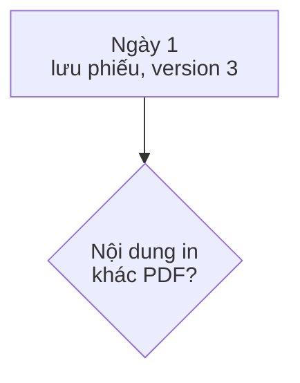

# Văn phong và xưng hô — team Sora

Áp cho mọi thứ viết ra ngoài chat: comment issue / PR, review, tin nhắn, thân issue, câu hỏi gửi khách. Luật quy trình (nháp → duyệt → kiểm live, thang quyết định, hạn trả lời khi hỏi khách) nằm ở `../../delivery-start/references/luat-chung.md`; file này chỉ giữ phần **của team Sora**: giọng, xưng hô từng người, ai là khách.

Bảng xưng hô ở §2 viết theo góc của người dùng hiện tại (Hòa, `sora-hoa`). Người khác dùng hồ sơ này thì sửa §2 cho đúng góc của mình.

## 1. Viết tiếng Việt cho người trong team

- **Giọng anh em trong team**, ngang hàng, không khách sáo. Bỏ "ạ" và các cụm nhún thừa ("nhờ anh…", "cho em hỏi…").
- **Ngắn, đi thẳng kết luận**, gạch đầu dòng.
- **Không chữ Nhật**: dịch sang tiếng Việt (議事録 → biên bản họp, 決裁会議 → cuộc họp quyết định). Giữ nguyên code identifier, số issue, số hiệu điều khoản.
- **Không jargon nội bộ** ("canon" → "bản đặc tả chuẩn trên wiki").
- **Giữ nguyên thuật ngữ kỹ thuật tiếng Anh**: merge, rebase, commit, push, branch, tag, deploy, image, promote, hotfix, migration, backfill, downgrade, CI, review, approve, port, adapter, payload… Viết "merge PR", không "gộp PR"; "review lại", không "rà lại". Thuật ngữ **nghiệp vụ** thì vẫn dịch (trượt thầu, thiết kế sơ bộ). *(16/10/2026: "gộp là cái gì, merge à?")*
- **Bỏ dấu gạch ngang dài (—)** trong câu, dùng dấu phẩy / chấm cho tự nhiên.
- **Không để mã trần**: mọi §, Q-x, AC-x, FR/BR, số cột CSV giải thích tại chỗ bằng lời. Ví dụ: "thông báo thay đổi v8.0 §113 (gửi 24/09) tách ô người thiết kế thành 2 ô; mục này thay §97 của v7.0 (gửi 16/09)". Mỗi comment có đoạn **"Thay đổi gì:"** để người đọc không phải hỏi lại.
- **Chỉ dùng `#N` cho issue / PR.** GitHub tự biến `#60` thành link; số cột, số mục viết "cột 60", "mục 3". Áp cả cho mô tả PR.
- **Dẫn nguồn cuối comment** khi comment dựa trên đặc tả: khối **"Nguồn"** gồm file bản ghim trong repo dev + version + § / mã FR, số § thông báo thay đổi (ngày gửi), cột bảng đối chiếu nếu có, link trang wiki PMS (`https://pms.sora-techs.com/user/wiki?sp=<projectId>&spage=<pageId>`) kèm mục. Không trích path kho tài liệu riêng của PM.
- **Nói về người phụ trách: "do X sẽ đảm nhiệm chính"**, không "X làm chủ". Đổi người nhận: "chuyển người nhận từ @A sang @B, vì …".
- **Chi tiết kỹ thuật lấy từ tài liệu của khách không phải thiết kế đã chốt.** Comment / issue nêu DDL, tên cột, cách lưu lấy từ đặc tả Malme thì kèm lưu ý: "phân tích và lên Solution trước, đối chiếu code + pattern của repo; vướng gì raise lại với anh". Kể cả điểm người dùng đã đề xuất: "đây là điểm xuất phát, khi làm thì phân tích lại, không dựa hoàn toàn vào đề xuất của anh".
- **Viết cho tester theo nghiệp vụ, không theo code**: thao tác trên màn hình và kết quả người dùng thấy ("người ngoài phạm vi không thấy nút xoá"). Không tên hàm / bảng / hằng số, mã HTTP, migration, path. Phần kỹ thuật cho dev tách thành đoạn riêng, ngắn.
- Comment gửi nhiều người cùng lúc: xưng hô theo từng đoạn gửi người đó.

*Nguồn luật:* anh Thái yêu cầu khi soạn comment đầu tiên của dự án 168 (giọng quá khách sáo, thừa "ạ", lẫn chữ Nhật và jargon, hỏi những thứ tự xác nhận được); sau đó áp cho cả team, chỉ đổi xưng hô.

## 2. Xưng hô từng người

| Người | GitHub | Xưng | Mở đầu comment | Ghi chú |
|---|---|---|---|---|
| anh Thắng | `brian-malme` | em – anh | "@brian-malme anh Thắng ơi, em…" | Người Sora, hơn tuổi (handle có "malme" nhưng không phải khách). Trong thân bài gọi "anh Thắng". Không viết JA + EN |
| anh Thái | `thainph-sora` | em – anh | "@thainph-sora anh Thái ơi, em…" | Chỉ tag khi người dùng bảo. Dự án người dùng làm PM thì không báo / không chờ anh Thái (memory dự án) |
| Đức Anh | `anhnd1209` | anh – em | "@anhnd1209 ơi, anh…" | Không "em ơi", không kết "nhé em", không "mình" |
| Minh | `minh-sora` | anh – em | "@minh-sora ơi, anh…" | như trên |
| Quang | `quangmalme` | anh – em | "@quangmalme ơi, anh…" | như trên |
| Huấn | `sora-huan` | anh – em | "@sora-huan Huấn ơi, anh…" | |
| Tiến | `tien-sora` | anh – em | "@tien-sora Tiến ơi, anh…" | |
| Trang (tester) | `trangthiminhlai` | anh – em | "@trangthiminhlai Trang ơi, anh…" | Trong thân bài gọi "em" hoặc "Trang", không "chị". Viết theo nghiệp vụ (§1) |
| Người khác trong team | | ngang hàng | "@tag ơi" hoặc "Tên ơi" | |

- Issue chưa có người nhận: viết trung tính, không mở đầu bằng @ ai.
- Tên tác giả commit có thể khác login GitHub; bảng đối chiếu nằm ở memory dự án (`team-roster`).

## 3. Viết cho khách Malme

- **Người chốt nghiệp vụ phía Malme:** Fujine-san (`@mamorufujine0503`). Hỏi khi nào và hỏi thế nào (JA + EN, hạn trả lời, phương án quá hạn, mời báo sớm): `../../delivery-start/references/luat-chung.md` §4.
- **Không tag Fujine trong comment nội bộ** của team, kể cả khi Fujine có mặt trong thread. Chỉ tag ở comment gửi Malme, viết JA + EN.
- Trả lời Fujine trong thread đang có: **không tự giới thiệu** ("Sora の Hòa です"), vào thẳng nội dung sau lời chào.
- Tin nhắn Slack trực tiếp với Fujine: người dùng có thể bỏ hạn và phương án quá hạn để hỏi gọn; hạn để dành cho comment GitHub.
- Người phía khách cuối (Yahagi, ví dụ Nishimoto) **không có tài khoản trong org** `structuralengine` (kiểm 01/10/2026), không tag được. Câu hỏi cho họ đi qua khối "text to send" trong issue (`../../delivery-write-issue/SKILL.md` → *Giọng và cập nhật issue*). Trước khi tag ai, kiểm bằng `search_users` với `q: "<tên> org:structuralengine"`; không bịa @.
- Comment cho người Nhật nói chung theo chuẩn JA + EN, không dùng giọng ở §1.

## 4. Sơ đồ Mermaid

Ngôn ngữ nhãn theo tài liệu chứa sơ đồ: tài liệu, comment tiếng Việt → tiếng Việt; thân issue GitHub → tiếng Anh; phần Malme đọc → song ngữ `EN / JA` (`../../delivery-start/references/so-do.md`). Nhãn tiếng Việt **viết có dấu đầy đủ**; Mermaid render Unicode bình thường. Chỉ tránh ký tự vỡ cú pháp, và tránh vì cú pháp chứ không vì tiếng Việt:

- `#`: Mermaid đọc là mở đầu entity. Viết `PR 645`, không `PR #645`.
- `:` trong `Note … :` và nhãn mũi tên.
- `(` `)` trong tên `participant`.

Giá trị thật (identifier, `tab=連絡`, tên cột, endpoint) giữ nguyên trong nhãn.

**Mọi sơ đồ đăng lên GitHub (comment, issue, PR, file `.md` trong repo): dòng đầu khối là dòng cấu hình tắt nhãn HTML.**

````markdown

````

- Lý do: GitHub vẽ nhãn trong khung HTML, đo chữ hẹp hơn lúc hiện ra rồi cắt phần thừa. Mỗi dòng có dấu mất khoảng 15% cuối, kể cả dòng ngắn ("lưu phiếu, version 3" còn "lưu phiếu, versic"), và sơ đồ rộng quá khung comment thì mất luôn mép trái. Ngắt dòng bằng `<br/>` không chữa được. Nhãn SVG không bị cắt: GitHub có đo lệch thì chữ chỉ lấn ra mép khung.
- Nhãn dài vẫn ngắt bằng `<br/>` trong `["…"]`, mỗi dòng khoảng 20 ký tự, để sơ đồ hẹp, lọt khung comment.
- Dấu `:` trong dòng cấu hình là cú pháp của nó, không thuộc luật tránh `:` ở trên.
- Đã kiểm với `flowchart` nhãn tiếng Việt (comment #774, 19/10/2026: hai lần ngắt dòng vẫn cắt chữ, thêm dòng cấu hình thì hiện đủ). Loại sơ đồ khác và nhãn tiếng Nhật, tiếng Anh chưa kiểm; dòng cấu hình vô hại nên thêm cho mọi sơ đồ.
- Không kiểm được bằng `gh`: API chỉ trả mã nguồn sơ đồ trong khung giữ chỗ, hình do trình duyệt vẽ qua `viewscreen.githubusercontent.com`. Repo private thì trình duyệt chưa đăng nhập cũng không mở được, nên đăng hoặc sửa xong thì nhờ người dùng xem lại.
